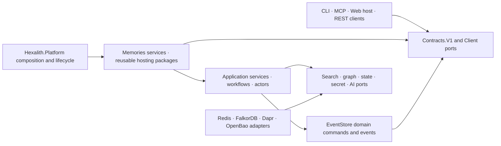
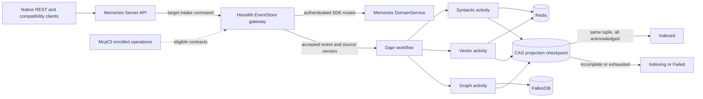

# Architecture Spine — Hexalith.Memories

> **Current McpCli disposition (Story 5.11 candidate):** The proprietary CLI/MCP phases, ingress topology and installation commands below describe retained compatibility. There is no promised generic migration or diagnostics surface. No Memories operation is enrolled in the current shipped McpCli cohort. Forwarded per-user HTTP authority is necessary but insufficient for retirement; tenant/user/administrative authorization, semantics, release and rollback evidence remain. PS14 stays owner-held local tooling in all four modes, never counted retired.


**Release decision, 2026-11-20.** Phase 1 remains **no-go**. The Administrator stewards the G1 corpus. Two independent reviewers, a frozen corpus, and a qualifying run are still needed. The default search and the enrolled CLI journey also lack qualifying evidence. L1–L3 remain unevaluated. [PRD release decision](../../prd.md#release-decision-record)


## Design Paradigm

**Shared environment ownership.** Hexalith.Platform operates shared local, CI and hosted environments through the Hexalith.Builds runner. Memories supplies the services, hosting declarations and probes. The local retention run and the conditions for reopening Production qualification are recorded under AD-17.

Hexalith.Memories is a **technical platform module**, not a domain module. It uses event-sourced CQRS with ports-and-adapters: Hexalith.EventStore accepts domain mutations, Dapr workflows coordinate durable projection work, Redis and FalkorDB hold rebuildable query models, and public surfaces depend on versioned contracts and client packages. Memories owns its reusable services, ServiceDefaults/Aspire integration packages and module declarations. Hexalith.Platform owns the shared AppHost composition, infrastructure and local/CI/hosted environment lifecycle through the supported Builds runner; Memories deployment assets are conformance inputs to that composition.

Logical dependencies point inward to contracts and ports. The current physical EventStore integration assembly is mixed; only its `Domain/` namespace is the dependency-pure domain center.



Rules below are the adopted target architecture. Where current code differs, the rule remains binding and the difference is implementation work, not a competing decision. Where a rule is not yet mechanically enforced, the rule or its ledger row says so; an unenforced rule is still binding but is a weaker guarantee. The Current Alignment Gaps ledger is the index of outstanding enforcement obligations, and the index is itself a rule: **a rule that names an owner, a store, a state vocabulary, a principal, or any other mechanism the architecture has not yet defined carries a ledger row naming that mechanism**, and a reader may treat an obligation absent from both the rule text and the ledger as not yet governed. A spine revision that adds such a rule without its row is incomplete; the reviewer gate found that omission in each of the three preceding passes, which is why the obligation is stated here rather than left to review.

## Invariants & Rules

### AD-1 — Treat Memories as a reusable technical platform [ADOPTED]

- **Binds:** All projects, packages, hosts, deployment assets, and consuming products.
- **Prevents:** Domain consumers depending on orchestration hosts or copying platform composition into product code.
- **Rule:** Consumers use published contracts, clients, and Aspire integration packages and never reference AppHost or Server; dependency-pure domain namespaces contain no orchestration, host, or provider-SDK concerns even when a brownfield assembly also contains integration code. Memories owns reusable services, hosting packages and declarations; Hexalith.Platform composes them in its AppHost and owns environment provisioning, readiness, run ownership and cleanup through Builds. For Production commands and replay, Hexalith.Platform supplies the external Hexalith.EventStore gateway endpoint, configures the deployment route to the Memories DomainService and owns operational readiness. Memories owns its native Server, DomainService image, SDK handlers, route declarations and consumer-side qualification. Its qualification evidence must exercise the authenticated gateway-to-DomainService route for each of the three declared domains. Reusable ServiceDefaults/Aspire packages do not transfer that lifecycle ownership to Memories.

### AD-2 — Keep EventStore as domain mutation truth [ADOPTED]

- **Binds:** FR75, case, MemoryUnit, annotation, deletion, tenant lifecycle, rebuild, restore, and release evidence flows.
- **Prevents:** Redis, FalkorDB, workflow state, or package topology becoming an accidental second system of record, and an availability restore being mistaken for an authoritative rebuild.
- **Rule:** Accept domain mutations through Hexalith.EventStore before reporting success, then rebuild derived stores from authoritative events; keep domain truth, Phase 1.5 CloudEvent indexing/causal integration, and source-versus-package evidence as three distinct contracts. Recovery keeps three inputs distinct: authoritative EventStore replay is the only rebuild that may set projection truth; shared Redis/FalkorDB projections and tenant-keyed coordination state have no operational backup-restore path and recover through that replay; application export restore is an import subject to normal ingestion rules. A historical or future derived-store snapshot that lacks AD-16 tenant-key protection is a purge target, never an availability shortcut. AD-16's erasure constraints override every recovery input, and authoritative replay, any admitted tenant-key-protected restore, and application import each consult AD-21's erased-tenant register before admitting a record and fail closed when it is unavailable.

**Recovery admission.** A pre-write refusal permits a retry only on a demonstrably clean, active target with the original live tenant ID and matching configuration. If writes may have occurred or verification fails, pause intake, preserve the partial state and keep the target offline. DW-733 requires a disposable live-tenant drill with final counts, searches on every required axis and an unaffected control tenant. An erased or uncertain origin remains fenced. [Restore stop conditions](../../../../docs/operations/backup-restore.md#rollback-and-stop-conditions)

### AD-3 — Complete source-versioned projections as one logical outcome [ADOPTED]

- **Binds:** FR6, FR13, FR75, ingestion status, retries, reconciliation, syntactic indexes, vectors, graph projections, checkpoint invalidation, concurrent tenant erasure, and query degradation.
- **Prevents:** Partial fan-out being exposed as complete, stale acknowledgements completing a newer revision, a legitimate new-epoch reprojection being suppressed as stale, a late write overwriting newer projected content or recreating tenant data after erasure has fenced it, a deliberately invalidated checkpoint being read as work never attempted, a write carrying a non-active tuple being dropped into a resource its phase never defined, or ingestion completeness being confused with query availability.
- **Rule:** One Dapr-state projection coordinator owns a durable checkpoint for each `(tenantId, caseId, memoryUnitId, schemaGeneration, embeddingConfigurationEpoch)`. Its current work is identified by `(sourceVersion, attemptRevision)`. The first value is the authoritative EventStore revision. The second is a monotonically increasing revision issued by that checkpoint’s coordinator. Ordinary retries and restarts reuse the pair. Every success or failure carries the pair issued before the work began.

**Starting and invalidating work.** On a newer source version, or detected projection loss or inconsistency at the current version, one ETag/CAS advances the attempt revision, preserves or advances the source version, and clears all three axis acknowledgements. Invalidation also records `reprojectionRequired` and its reason. It expects the previous version and attempt, so repeating the same invalidation has no effect. The durable record lets a restarted coordinator resume the outstanding attempt. A missing record means first use only when continuity of the coordinator store and the current generation establishes that the checkpoint was never created.

**Coordinator loss.** When an established checkpoint disappears or may have rolled back, stop dispatch and acknowledgement counting for its scope. Report repair pending. To reuse the same generation, recover a proven upper bound on every attempt revision already issued for that checkpoint, including in-flight work, then CAS a new revision above that bound with all acknowledgements empty. A surviving target's last observed revision alone cannot prove that bound. If issuance history is uncertain, recover by authoritative replay into a fresh, never-reused AD-14 schema/epoch pair under the applicable migration and admission rules. Only fresh confirmations in that pair can establish completion. Until verification and cutover, the affected status stays pending or failed with recovery guidance.

**Target write fence.** For each checkpoint identity, every axis maintains a durable target-local fence ordered first by source version and then by attempt revision. The coordinator authorizes installation of the current pair. Installation may advance the fence or confirm it idempotently. A superseded installation cannot lower it. Each projection upsert, delete and tombstone atomically compares its own pair with the installed fence in the operation making the mutation visible. Only an exact match may write. The fence survives loss or deletion of the document. Ordinary work cannot create or reset a missing fence. If an established target loses the fence itself, the adapter closes admission to writes and fence installations for that scope. Recovery must drain or revoke all prior write and installation authority, verify that no old operation can still commit, then obtain the current pair from the coordinator and durably install it before reopening. If that proof is unavailable, the target stays closed.

**Completion.** After its current fence is installed, an axis writes or verifies the projection for this source version under that fence. Only this observation can acknowledge the issued attempt. A coordinator CAS counts each axis once and only against the exact current pair. Delayed writes, successes and failures from older attempts cannot displace repaired data or supply completion evidence. Only all three current syntactic, vector and graph acknowledgements permit `Indexed` and clear `reprojectionRequired`. Otherwise the persisted state remains `indexing` with the relevant reason or records actionable failure. Status, case activity and counters publish the same transition. Use the V1 wire vocabulary in Consistency Conventions.

**Projection scope.** Each schema generation and embedding epoch has its own checkpoint and derived document for the unit. The active pair and each declared AD-14 rebuild or staging pair write disjoint documents. Undeclared pairs produce an actionable out-of-generation failure. Public ingestion status follows the tenant’s active pair. Other pairs report only migration progress. Queries read through the AD-10/AD-14 lease. AD-14 retirement removes the retired documents, checkpoints and target fences only after readers have drained and late writers and installers have been fenced out.

- **Concurrent-erasure fence:** Every projection activity captures AD-16's tenant lifecycle write generation when its work is admitted. Every target fence installation or recovery, syntactic, vector, graph, derived-document-tombstone, and checkpoint write presents that generation and compares it atomically with the target's writable generation in the same backend operation that would make the write visible; a separate lifecycle read followed by a write does not satisfy this rule. A stale or closed generation rejects the write without mutating projected state. Where a target cannot provide that atomic comparison, its adapter must instead prove that the tenant-scoped write authority has been revoked before AD-16 begins purge.

A managed-source refresh exposes only the published version across retrieval axes. The read path refuses a changed publication window that it cannot verify. This visibility check supplies no missing axis acknowledgement.

### AD-4 — Give workflows, activities, actors, and idempotency distinct roles [ADOPTED]

- **Binds:** FR75, Dapr orchestration, retries, actor state, concurrency, replay, external I/O, duplicate suppression, and durable state content.
- **Prevents:** Nondeterministic replay, actors used as queues, duplicate side effects, secrets or tenant content in workflow history, and transient Redis reservations becoming durable truth.
- **Rule:** Workflows are deterministic process managers, activities are bounded idempotent I/O operations, and non-reentrant actors serialize only tenant or global stateful concerns. Capture immutable non-secret configuration plus its epoch at start and retain secret references only. Workflow history and activity payloads carry identifiers, references, and non-secret configuration only: tenant content and content-derived material — extracted text, embeddings, snippets — are read at execution time from the **tenant content store** and are never persisted into workflow history or actor state. That store is a named tenant resource, not a property: AD-6 provisions and erases it with the tenant's other resources, its contents are written under the tenant key so AD-16 crypto-shredding reaches them, AD-16 names it in its enumerated purge targets, access to it derives tenant authority under AD-5 like any other tenant resource, and its capacity is an AD-18 tenant quota. An activity that cannot resolve it fails closed rather than falling back to a payload. Scope V1 `IdempotencyToken` by tenant, case, and command/operation; scope CloudEvent identity by tenant, case, validated `source`, and `id`. `source` and `id` are externally supplied and are therefore validated at the ingress trust boundary against a declared bounded character set, length-bounded, and canonicalized there exactly once in a stated form (scheme and host lowercased, no other change); thereafter they are compared ordinally with no further normalization. Because neither is issued under AD-23's grammar, neither is composed into a key in raw form — AD-23's injective-composition rule governs how they enter one. The shipped reservation key hashes `id` and omits `source`, so it does **not** implement this identity and remains an alignment gap. Use the adopted identity for durable EventStore/workflow duplicate suppression and make every projection an idempotent upsert for AD-3's tuple; a legitimate reprojection under a new schema generation or embedding-configuration epoch is not a duplicate and is never suppressed. Redis preflight is a fail-open admission optimization with a finite TTL. A CloudEvent preflight hit without confirmed durable acceptance yields a retryable outcome. Each successful acquisition stores its own fresh, opaque token. Every failure or cancellation cleanup, including cleanup after an uncertain write, atomically compares the stored token and deletes only a matching reservation. An acquisition token is distinct from the stable operation identity and is never reused on retry. TTL bounds cleanup when ownership cannot be confirmed.

For URL ingestion, logs and case activity identify work by its unit or workflow ID throughout enqueue, fetch, retry, duplicate and failure paths. The fetcher receives the original URL, and the deduplication identity preserves it within tenant and case scope. The durable workflow needs a reference to retrieve that value under the content rule above. DW-732 covers display and scoped identity. The history gap is recorded below.

### AD-5 — Derive tenant, case, and caller authority server-side [ADOPTED]

- **Binds:** NFR8-NFR11, external APIs, MCP, Dapr ingress and pub/sub delivery, tenant/case access, Redis, FalkorDB, background and resumed durable work, system and operator principals, and the operator artifact. Identifier issuance and key composition are AD-23's.
- **Prevents:** Request fields, envelope fields, case membership, key prefixes, graph labels, channel tokens, or a caller-selected app identity from serving as authorization; two writers of one authorization decision; a privileged principal that authorizes work while being derivable from nothing; and an exempt class of work that no mechanism binds to a tenant.
- **Rule:** Treat issued tenant and case IDs as validated opaque tokens and compare them with `StringComparison.Ordinal`, without case folding or Unicode normalization after issuance; AD-23 owns what makes them safe to compare that way. The native REST and compatibility CLI/MCP paths preserve validated bearer tenant and subject authority. The shared Gateway calls under workload authority and forwards no user credentials. Before enrolling an operation that needs a user, demonstrate its authenticated tenant and user authorization, including denied access, on the selected transport. A caller-supplied tenant or actor value cannot satisfy this requirement. Trusted internal calls additionally require deny-by-default Dapr mTLS/access-control policy and app-token channel protection, then satisfy three independent checks — an app ID present in the allowlist, an explicit grant for the requested tenant, and that tenant being currently `Active` in AD-6's lifecycle state machine — any one of which failing closed. **One deployment-time artifact, the operator artifact, carries three operator-controlled identity, privilege, and routing facts plus their revocation bound** — the app-ID-to-`system:*` allowlist, the per-operator-scoped-app-ID list of lifecycle operations each may invoke, and the exact authenticated pub/sub channel-identity tuple `(subscribing component, topic, authenticated publisher)` to candidate-tenant routing map — with exactly one writer, the operator, held in AD-15's operator secret scope rather than in ordinary configuration or component YAML, versioned, and changed only through a reviewed and observable procedure. The allowlist and operation list grant principal identity and privilege; the routing map selects a candidate tenant but never grants tenant authority. An absent app ID fails closed with no default principal; grants are enumerated and any wildcard requires its own architecture decision. **An operator principal is an ordinary authenticated identity marked operator-scoped in that artifact** — a human operator's OIDC issuer-plus-subject or an allowlisted workload app ID, authenticated by the same mechanisms as every other principal, carrying no tenant claim by construction. Because it carries none, NFR8's principal-driven verification is extended to cover it: the isolation suite authenticates as an operator principal and asserts that every non-exempt operation it attempts against a tenant is refused. The per-tenant grant that pairs with the allowlist is a tenant resource whose sole writer is AD-6's lifecycle workflow. Its **membership at provisioning is an explicit app-ID set in the tenant's AD-6 lifecycle evidence, authorized by the initiating operator principal and limited to app IDs already present in the operator artifact's allowlist**, then materialized by verified provisioning; adding or removing an app ID on a live tenant is an AD-6 grant-amendment lifecycle operation and not an edit to the operator artifact; and every grant is revoked as a completion condition of AD-16 erasure. **Revocation propagates within 60 seconds:** the versioned AD-5 operator artifact is the authoritative home of `revocationMaxAgeSeconds = 60`; a revoked grant, removed allowlist entry, or withdrawn operator authority stops authorizing within 60 seconds of its committed or published change. No cached authorization decision, session, or in-flight durable work established under superseded authority outlives that window; long-running activities refresh authority or stop before it expires, and unavailable freshness proof fails closed. A longer value requires a new architecture decision. AD-15 uses the same bound for rotated credentials. Dapr pub/sub ingress derives tenant authority from the delivery channel and never from the envelope: **the receiving component or topic is bound to one candidate tenant, or the operator artifact maps the delivery's authenticated channel identity — the subscribing component and topic, and the publisher identity Dapr authenticated — to one candidate tenant. Admission then applies the same allowlist, explicit per-tenant grant, and `Active` lifecycle checks as any trusted internal call. No field the publisher sets may select or authorize the tenant, and `source` is a publisher-set envelope field:** a routing map keyed on `source` lets a publisher choose the tenant it writes into and is forbidden by this decision's own *Prevents*, whatever its matching rule. The shipped `TenantEventRoutingOptions.SourceToTenantMap` is exactly such a map and is an alignment gap, not an implementation of this rule. Channel-identity tuple lookups are exact and ordinal; an envelope tenant that differs from the authorized candidate tenant is rejected rather than ingested, a delivery whose channel resolves to no tenant is rejected, and the resolved tenant must pass all three internal-call checks. Work with no human caller — workflows, activities, actors, reminders, data repair, replay, and migration — carries an explicit tenant authority captured at initiation, revalidates it against the tenant's lifecycle state on every resume and at each activity boundary, and fails closed when the tenant is not `Active`, is erased, or is absent from the initiating principal's grant; captured configuration is not authority. **Exactly three exemptions from that fail-closed exist, and no other decision may add a fourth without amending this list.** (1) AD-6 lifecycle workflows and (2) AD-16 erasure act on their own subject's lifecycle state, so they revalidate the lifecycle state for that operation. After shredding, only the AD-16 verifier may use its generation-bound platform preparation to finish the same deletion, subject to the operator and lineage checks below. Each such workflow is authorized by an operator principal; is **scoped at initiation to exactly one tenant identifier recorded in its lifecycle evidence, which it may not change on resume or retry**; revalidates that operator principal — not the tenant — at every resume and activity boundary and fails closed when its authority has been withdrawn; and reaches **only the operations the operator artifact enumerates**, which are exhaustively: tenant provisioning and tenant-resource creation, tenant verification, lifecycle repair, grant amendment, per-tenant credential rotation, tenant-resource migration setup and retire, access-telemetry partition provisioning and revocation of ordinary access at erasure handoff, tenant deactivation, tenant deletion, and AD-16 erasure including tenant-content-store erasure and generation-bound completion. Every other call such a workflow makes satisfies all three internal-call checks. **No enumerated operation may create, re-provision, or restore any resource for a tenant present in AD-21's erased-tenant register**, and an enumerated operation that cannot reach the register fails closed. The exemption travels with the calling principal and never with the request: a receiving service recognizes a lifecycle call from the authenticated caller identity mapped through the operator artifact — never from a header, flag, or field the caller sets, which `Prevents` forbids — accepts it only for an enumerated operation, only from an app ID the artifact marks operator-scoped, and only when its authenticated workflow-instance scope reference resolves to the same single tenant identifier recorded in the lifecycle evidence; the request tenant must equal that bound tenant. It applies all three internal-call checks to every other call from that same identity. An all-tenant grant remains a wildcard requiring its own architecture decision and is not created by this clause. (3) AD-17 retention accounting, including acknowledgement of a handoff for the single tenant in `Deleting`, post-erasure TTL expiry, removal of the empty retained partition and its locator, and the separate purge receipt, is authorized by Platform Operations' own operator-scoped principal and is bounded in AD-17. Adding an operation or an exemption to this list is an architecture decision, not a configuration change. Dapr channel authentication never replaces tenant authorization.

- **Platform bootstrap boundary:** AD-21 genesis creation is a one-time platform operation under AD-15's authenticated deployment-bootstrap identity and secret scope, not a tenant-scoped call or a fourth lifecycle exemption. That identity has no tenant-data, tenant-resource, export, or tombstone capability; ordinary deployment and Server startup can verify an existing genesis only. The AD-15 deployment bootstrap scope records an expected `populationId` and one-time consumed grant outside EventStore; genesis creation is permitted only for a first-ever population while that grant is unconsumed, and uncertainty fails closed. A missing or mispointed prior lineage may never be treated as a fresh population by a routine restart. A clean-room population after total lineage loss requires a separate architecture decision on disjoint identity issuance.

### AD-6 — Make tenant lifecycle the sole resource owner [ADOPTED]

- **Binds:** Tenant provisioning, verification, repair, deactivation, deletion, the tenant lifecycle state machine, operator authorization of lifecycle work, the AD-21 erased-tenant register consult, indexes, graphs, backend identities and credentials, per-tenant grants, the tenant content store, the access-telemetry partition, and cleanup.
- **Prevents:** Startup or ingestion hot paths implicitly creating tenant resources and leaving unowned partial resources behind; an erased tenant identifier being re-issued or its resources re-created by repair; and a lifecycle state that authorizes work while no decision enumerates it.
- **Rule:** Perform tenant resource changes only in explicit, idempotent, observable, bounded lifecycle workflows with verification, compensation, and resumable cleanup. **AD-6 owns the tenant lifecycle state machine and is its sole writer.** Its states are the `Contracts.V1` `TenantStatus` values — today `Provisioning`, `Active`, `Deleting`, `Failed`, `CompensationFailed`, extended additively under AD-12 with `Deactivated` and with `Erased`, which is terminal and irrevocable — and that enum is the single definition site for the vocabulary; no decision, surface, or store defines a parallel one. Every transition except terminal `Erased` is an AD-2-committed domain event on the `memories-tenants` stream and is committed **before** the resources it authorizes are touched. `Erased` is derived only from AD-21's irreversible platform tombstone; no event is appended to the shredded tenant stream after completion. Because AD-16 crypto-shredding destroys the tenant key, a content-free projection of each tenant's identifier, current state, and transition time is mirrored onto AD-21's platform partition for post-shred observability. **That projection never authorizes a request:** every admission of ordinary ingress or a tenant-content read for a non-erased tenant reads its authoritative committed `memories-tenants` state and requires `Active`; an unavailable authoritative read fails closed. Each product read holds its own bounded lease from the tenant's query-admission gate. At admission it binds the tenant lifecycle generation and one active pair (schema generation, embedding epoch) and holds that lease through the last response byte. AD-14 cutover keeps the admitted pair readable until the lease drains. Erasure revocation stops egress even for a leased pair. No cached copy held by the tenant configuration actor or lagging platform mirror supplies authority. The `Erased` state is set **from** AD-21's register rather than beside it — the register remains the sole authority on erasure and the state machine reads it — so the two can never disagree. Provisioning is authorized by an operator principal under AD-5 and **consults AD-21's erased-tenant register before issuing a tenant identifier**, failing closed when the register is unavailable, unreadable, or older than the newest erasure it records; provisioning and lifecycle repair refuse any tenant in `Deleting` or `Erased`, so no compliant repair can re-create an erased tenant's ACL principal, graph, telemetry partition, or grant. Redis uses a per-tenant ACL principal resolved server-side; FalkorDB selects a separate tenant database/graph; AD-6 provisions the isolated AD-4 tenant content store and erases it under AD-16. It also provisions the AD-17 telemetry principal or partition. During erasure it closes ordinary access and hands the retained opaque records to Platform Operations. AD-17 governs final partition removal after expiry. Other paths require an `Active` verified tenant and never create infrastructure implicitly.

- **Legal transitions:** New identifiers enter `Provisioning`; `Provisioning` may enter `Active` only after resource verification, or enter `Failed`, `CompensationFailed`, or `Deleting`. `Failed` and `CompensationFailed` may return only to `Provisioning` through authorized repair, or enter `Deleting`. `Active` may enter `Deactivated` or `Deleting`; `Deactivated` may return to `Active` only through verified reactivation, or enter `Deleting`. `Deleting` may resume in place without changing its write generation and reaches `Erased` only from AD-21's irreversible tombstone; it never returns to an authorizing state. `Erased` has no outgoing transition. Every other transition fails closed. The first commit entering `Deleting` advances the tenant lifecycle write generation and fences ordinary writes; retries preserve that generation, and no failure status restores admission. Before that commit, the lifecycle workflow durably closes the tenant's serialized AD-4/Dapr query-admission gate and waits for every bounded in-flight tenant-content response to end or for its sender to acknowledge cancellation and no further egress. All product readers that may emit tenant content acquire their own request permit before the authoritative `Active` read and pin one active read pair before fan-out. The permit covers all subreads and egress through the last response byte. On erasure revocation, the sender stops all subsequent egress and acknowledges cancellation before the lifecycle workflow can proceed. A cutover lease cannot override that fence. A lost or unavailable gate fails closed, every sender must stop before emitting another byte when it cannot renew its permit, and absence of gate state alone is never evidence that an admitted sender has drained; a failed Deleting commit may reopen the gate only after an authoritative `Active` read with unchanged lifecycle generation and confirmed permit reconciliation. The gate is coordination, never lifecycle authority. The same authoritative tenant-lifecycle stream owns AD-16's release-intent begin/end/cancel records: release begin requires `Active`, and `Deleting` cannot commit until every active intent has a terminal record. A cancel record is admitted only after the egress sender has stopped and acknowledged that no later bytes can leave, or its egress capability has been revoked and that revocation is confirmed; a mere cancel request is not terminal. Dapr transfer leases mirror those records for coordination and do not authorize release.

### AD-7 — Enforce case ownership across case and tenant query scopes [ADOPTED]

- **Binds:** FR32-FR34, MemoryUnit ownership, case-scoped and tenant-wide search, graph seeds/paths, annotations, mutations, deletion, Evidence Packets, and G4.
- **Prevents:** Case-local graph traversal leaking across cases, tenant-wide discovery being incorrectly rejected, deferred cross-case references becoming accidental, or case being silently treated as a confidentiality boundary the architecture does not implement.
- **Rule:** Resolve authoritative case ownership server-side and assign every MemoryUnit to exactly one case. A case-scoped query filters every candidate, result, node, and edge to that case. A tenant-wide query may return independently ranked units from multiple cases with mandatory case attribution, but partitions graph seeding/traversal by each seed's authoritative case and never crosses case boundaries. Mutations, annotations, and deletion verify the unit's owner case; cross-case references and paths remain forbidden. **Case is a data-partition and attribution boundary, not an authorization boundary:** a principal with tenant authority may read every case in that tenant, and case-scoped queries constrain results rather than access. Per-case authorization is deferred, and until it is adopted no product documentation may present cases as an access-control mechanism.

### AD-8 — Enforce infrastructure boundaries at named adapters [ADOPTED]

- **Binds:** Dapr state/pub-sub/actors/workflows/secrets/conversation, Redis data-plane operations, FalkorDB graph operations, and architecture guards.
- **Prevents:** Provider clients and connection details leaking into endpoints, workflows, actors, domain code, public services, or contracts.
- **Rule:** Server and EventStore integration are the physical adapter assemblies. Provider SDK references **must be** confined to composition roots and to named internal `Adapters.Redis` or `Adapters.FalkorDb` namespaces, enforced by an architecture test **still to be added**: neither namespace exists today and no guard enforces the boundary, so this rule is binding but currently unenforced and its convergence is ledgered. Direct search/vector/graph data-plane work stays behind those adapters; portable coordination state uses Dapr. Only the finite Direct Redis Exception Registry below may bypass Dapr state. Its preflight exception binds the REST and CloudEvent paths to the same AD-4 acquisition and atomic release rules. Any addition requires a new architecture decision. `Hexalith.Memories.Redis` remains a compatibility facade, not the adapter owner.

### AD-9 — Fuse independent retrieval axes deterministically [ADOPTED]

- **Binds:** G1, syntactic, semantic, graph, natural-language ranking, candidate depth, pagination, result ordering, degradation, and explainability.
- **Prevents:** Backend magnitudes being blended, missing graph starts silently disabling required hybrid retrieval, an unbounded candidate set or a pushed-down page offset changing ranks, a silently truncated axis reporting healthy, backend loss causing avoidable total failure, or ranking implementations diverging.
- **Rule:** In provider order, drop blank IDs and non-finite raw scores, retain the first occurrence of each exact `MemoryUnitId`, and treat scores as tied only when finite `Double.Equals` returns true—no epsilon—then assign competition ranks (`1,1,3`). The internal raw RRF term for rank `r` is `1 / (10 + r)`. V1 exposes the unweighted, top-rank-normalized per-axis value `raw(r) / raw(1)` on hybrid evidence and explain surfaces. Rank one yields `1/11` internally and `1.0` on the wire. Rank two yields `1/12` internally and `11/12` on the wire. Single-axis search retains its axis-specific score semantics. The per-axis candidate depth is a **single deployment-wide, configuration-validated value** identical across every surface, tenant, caller, page, and load condition; admission control, backpressure, and per-tenant quotas may never shrink it — AD-18 rejects or delays work instead — and the depth in force is reported in the Evidence Packet so that two answers produced under different depths are distinguishable. Fusion is defined over each axis's complete server-limited candidate list. For tenant-wide graph search, partition seeds by ascending ordinal case ID, retain each unit's maximum finite graph score across seeds within its case, and merge by descending graph score, ascending ordinal case ID, then ascending ordinal `MemoryUnitId` before rank allocation. Normalize the sum of weighted **raw** terms by `raw(1)` times the sum of weights of axes that returned results, then sort by descending composite score and ascending `StringComparer.Ordinal` ID. **AD-22 owns the axis-state vocabulary, its denominator consequence, and its encoding, and AD-9 consumes it rather than restating it:** an axis contributes its weight to the denominator **if and only if it returned at least one result**, whatever its state — so `available` with no hits and `truncated` with no hits both contribute none, and neither a state name nor the word “degraded” ever overrides the returned-results test. Default weights are `0.30/0.35/0.35`. `nl` is a fourth ranked axis and not a rerank: when requested and configured for Phase 1.5 event units it is canonicalized, competition-ranked, and contributes at weight `0.20` inside the same weighted sum, default-off, entering the denominator only when it returned results, appearing in Evidence Packet axis health and in explain output under the wire name `nl`, and selectable through the axis-control parameter; where NL is inactive it is reported as an excluded axis rather than omitted. Without an explicit graph start, traverse to depth at most two from the union of the first five entries of the canonicalized syntactic list and the first five of the canonicalized semantic list — five entries, not five ranks. Apply AD-11's result limit once to the merged graph list after the per-case merge and before rank allocation, never per case partition, and apply AD-11's time limit once to the whole tenant-wide fan-out. Each offset request queries the current authorized view. Apply the caller’s limit and offset after fusion, normalization and final ordering. With the same query, scope, configuration, candidate data, expiry/freshness inputs and axis availability, consecutive pages concatenate to the head of that ordering with identical scores for each unit. Each later request acquires its own AD-10 lease. Changes to the corpus, active pair, configuration or axis responses between requests can repeat or skip units at the page boundary. V1 offset pagination provides no cross-request snapshot. The fused ordering is finite and bounded by the candidate depth: a request whose offset reaches or exceeds its length returns an empty page whose Evidence Packet reports the fused list's total length and states whether that length was bounded by the corpus or by the candidate depth, so exhaustion of the corpus and exhaustion of the depth are never confused.

### AD-10 — Serve safe available axes during query degradation [ADOPTED]

- **Binds:** FR66, NFR18, search/traversal responses, Evidence Packet degradation, readiness, and recovery.
- **Prevents:** The all-three ingestion gate being misapplied to already-admitted reads, a partial outage returning deceptively complete results, or each adapter applying a private safety doctrine that silently moves every composite score.
- **Rule:** Before fan-out, each authorized tenant query acquires from the tenant configuration actor an AD-14 lease on the concrete `(schemaGeneration, embeddingConfigurationEpoch)` active at admission. All selected adapters, including graph traversal, read using that immutable pair. An axis is safe only when it applied the request’s authoritative tenant and case scope to every result and reports reading exclusively from the leased pair. A missing or mismatched pair makes that axis `unavailable`; AD-22 supplies its encoding. Losing the lease or the AD-6 query-admission permit stops the entire response, including any remaining egress. A retry starts a new authorized query. Completing within configured limits is not a condition of safety: an axis that hit a traversal, result, provider, or time cutoff while keeping scope verified is safe and `truncated`, and only unverified scope or a generation/epoch mismatch makes it unsafe. Staleness, low recall, empty results, and reaching AD-9's configured candidate depth are safe and are disclosed as freshness, emptiness, or depth; unverified scope and a generation or epoch mismatch are unsafe and null the axis. A cutoff exhausted such that the applied scope cannot be verified is unsafe; a scope-verified incomplete axis is AD-22's `truncated` state, which is safe and disclosed, while AD-22 alone determines from returned results whether it contributes denominator weight. **Safety is decided once per query by the server's axis-selection step, never independently by each adapter, and it is decided only from the facts AD-22 obliges every adapter to report** — the server never infers scope application or truncation from a result set's shape, and an adapter that reports nothing is scope-unverified and is nulled. The resulting state vector is the single input to both AD-9's denominator and the Evidence Packet's axis health. Query every selected usable axis and return a partial result when at least one can respond safely; list every selected axis with its AD-22 state, together with degradation, freshness impact, and recovery guidance, in the Evidence Packet. While the lease and authorization remain valid, fail the query only when no selected axis can produce a safe response. This never promotes an incompletely acknowledged revision to `Indexed`.

### AD-11 — Bound and phase graph behavior [ADOPTED]

- **Binds:** G1, graph population, traversal, case/tenant isolation, relationship semantics, kill switch, and backend portability.
- **Prevents:** Query injection, cross-scope paths, unbounded traversal, arbitrary labels, and premature claims of automatic EventStore causal coverage.
- **Rule:** Parameterize values, restrict labels to the contract enum, enforce tenant and case scope over every node and edge, and apply server-owned depth/result/time limits plus a graph kill switch; AD-9 fixes where those limits are applied. Phase 1 creates `contains`, `annotates`, `references` from explicit links or AI-inferred content similarity, and `caused_by`/`correlated_with` only from supplied ingestion metadata, never collapsing `caused_by` into `correlated_with` and never auto-promoting inferred edge confidence. Phase 1.5 adds automatic EventStore-stream causal population and dual event embeddings.

### AD-12 — Share one semantic contract across surfaces [ADOPTED]

- **Binds:** NFR37, Contracts.V1 ownership, Evidence Packet, routes, statuses, errors, exit codes, REST, Dapr invocation, CLI, MCP, and future Web hosting.
- **Prevents:** Interface-specific identifiers, ranking semantics, trust envelopes, or persistence models escaping through public types; two additive changes colliding on one wire name; and one packet meaning being carried by two mutually unreadable encodings.
- **Rule:** Evolve Contracts.V1 additively and preserve deliberate wire names until a versioned break. `Hexalith.Memories.Contracts` is the single owning component for `Contracts.V1` and its maintainers hold change-approval authority over that wire surface, and an additive change is admissible only once its new wire name, JSON shape, and nullability are reserved in the contract's versioned name register in the same change; a reserved name may not be reused with a different shape, and a collision is resolved before merge rather than by a later rename. **The name register is a single tracked file inside `Hexalith.Memories.Contracts`**, every closed set the contract exposes — AD-22's axis states, the packet states below, the V1 status wire values, and the error-code catalogue — is reserved in it as a closed set extensible only by a registered additive change, and an architecture test **still to be added**, its convergence ledgered, fails the build when a serialized evidence-bearing wire name is absent from the register or is reserved with a different shape. Capability subsets may vary operations, never Evidence Packet semantics: every evidence-bearing result carries tenant/case scope, source/origin, confidence and per-axis contribution, degradation/excluded axes, omitted-detail handles, freshness, and recovery. **Equivalence is equivalence of the serialized document:** every element is always present on every surface, an unavailable axis or absent value is an explicit JSON `null` and never an omitted property, an available-with-no-hits axis is an empty collection, no surface enables null-omitting serialization for evidence-bearing types, the packet state is a single value drawn from the versioned vocabulary — `complete`, `partial`, `weak`, `empty`, `stale`, `degraded`, `unauthorized`, `pendingExpansion`, which is the shipped `Contracts.V1` `EvidencePacketState` enum and is its single definition site — with an accompanying set-valued reason list. Before serializing that list, the Contracts producer removes duplicate wire reason codes using `StringComparer.Ordinal` and sorts the remaining codes in ascending ordinal order. All surfaces embed that canonical array. Hybrid per-axis contribution fields carry AD-9’s top-rank-normalized V1 values. **Equivalence is byte-equality of one canonical document:** properties serialize in the name register's declared order, `double` values use round-trippable invariant `R` formatting, strings use minimal JSON escaping, and no surface reformats, reorders, or rounds the packet; each surface embeds that exact byte sequence as its packet payload while its own transport framing — HTTP body framing, the CLI JSON envelope, the MCP content block — is excluded from the comparison, and the golden-vector test compares the extracted packet bytes across REST, Dapr invocation, CLI JSON, and MCP rather than whole responses. A handle is emitted only for detail the caller is authorized to retrieve; **detail withheld for authorization is represented by the same present properties with canonical JSON `null` values and the same bytes as ordinary absence, and no handle is emitted**, so withholding cannot be distinguished from absence. Handles are opaque, non-enumerable, scoped to the issuing caller and request, and carry no score, count, or scope information about unauthorized content. Each active surface additionally publishes an operator-observable output contract: a stable presentation order, a text label for every state, axis, score meaning, omission, progress stage and recovery, a machine-readable envelope and exit-code map, and identical semantics across every emitted form, with colour, glyph, motion, and screen position supplementary only. `Hexalith.Memories.Contracts` owns the wire-name register for public V1 routes and the internal AD-17 telemetry and clock routes. The internal `/v1/access-telemetry/*` and `/v1/time/attest` contracts reserve their names, shapes and nullability in that register and map errors from the V1 catalogue. Only authorized internal workload and operations callers may use these routes. AD-19 lists their projects in `nonPackableProjects`; the service images may be deployed under that internal contract. External exposure requires a subsequent architecture decision naming the consumer, authorization and compatibility contract, followed by the corresponding AD-19 publication change before access is enabled. MCP and EventStore CloudEvent product capabilities remain inactive until Phase 1.5 L1-L3 gates pass, even if deployment assets exist; inactive means unreachable, not merely unadvertised — no route, ingress, or replica serves them until the gate passes.

**Surface ownership.** Memories owns the decorated Contracts commands or queries, handlers, routing and admission for eligible operations. Hexalith.McpCli owns the shared CLI and MCP presentations. Keep the compatibility binaries available until each operation passes its authorized replacement or withdrawal checks. The approved Story 5.10 inventory defers search (L03) and tools M01–M04 and withdraws the compatibility wizard (L06). The applicable target operations and their accessible outputs still need delivery and proof for FR53, NFR31 and NFR37. [Owner inventory](../../../../references/Hexalith.McpCli/_bmad-output/implementation-artifacts/memories-migration-inventory-v1.1.0.md) · [Approval receipt](../../../../references/Hexalith.McpCli/_bmad-output/implementation-artifacts/evidence/story-5-10/approval.json)

### AD-13 — Preserve provenance and opaque identity end to end [ADOPTED]

- **Binds:** Origin, actor, confidence, source, freshness, explanations, correlation and causation identifiers, and `MemoryUnitId`.
- **Prevents:** Forged actor identity, one principal splitting into several across surfaces, provenance lost during projection, unauthorized explanations, and parsing identifiers for undocumented GUID, ULID, or time meaning.
- **Rule:** Bind external actor provenance to the authenticated issuer plus subject claim, normalized exactly once at the authentication boundary in a stated form and compared ordinally thereafter, so the same human yields the same recorded actor on every surface. Permit system origins only through AD-5's allowlist, carry provenance into every projection and Evidence Packet, and authorize before explaining evidence. Supplied correlation and causation identifiers are opaque provenance preserved through projection and distinct from W3C trace context. Otherwise compare `MemoryUnitId` only as an opaque stable string.

### AD-14 — Evolve schemas and providers with phase-qualified tenant migrations [ADOPTED · ratified 2026-09-12]

- **Binds:** Embedding provider/model/dimension, index and key families, graph/search replacement, reindexing, provider strategies, and the MVP/Phase 2/Phase 3 migration boundary.
- **Prevents:** Destructive in-place changes, mixed embedding dimensions, partial tenant activation, provider SDK leakage, and an unphased rule silently rebaselining MVP onto a contract the product has not funded.
- **Rule:** Migration obligations are phase-qualified and no phase's evidence satisfies another's. In **Phase 1 / MVP**, FR43 permits only a tenant-scoped, explicitly acknowledged degraded rebuild of rebuildable projections. **That rebuild allocates a new `embeddingConfigurationEpoch` and writes under it, and activates it atomically for the tenant when its verification succeeds** — it is the sole writer permitted to target the new epoch, ordinary ingestion continues under the epoch that is active until the moment of activation, and the tenant's reported ingestion state follows the current active pair and each AD-10 query reads only its leased pair, so the rebuild never flips a tenant's whole corpus into `indexing` and never mixes two embedding spaces under one epoch. Activation is a single AD-2 commit. After the superseded pair’s outstanding read leases drain, the tenant migration workflow’s resumable retire step deletes its documents and checkpoints and verifies removal. The command discloses impact and progress, fails closed on incomplete verification, preserves authoritative EventStore truth, and never claims zero downtime; the query gap between allocation and activation is exactly the degradation FR43 requires it to acknowledge. In **Phase 2**, embedding provider/model/dimension and index-schema changes use versioned create-backfill-verify-switch-retire migrations with disjoint active and staging resources and a full-tenant reindex before atomic activation, with no availability break. In **Phase 3**, backend replacement uses the same staged cutover at the adapter boundary. **Every phase in which a non-active generation or epoch may be written declares what that write targets, for every store AD-3's fence covers — syntactic index, vector index, graph, and tombstones — and AD-3 rejects only a write that matches no declared pair.** Phase 1 declares exactly one: the rebuild epoch above, which needs no separate resource because AD-3 makes the epoch part of a document's identity. What is **Phase 2 and Phase 3 only, by explicit statement rather than by silence**, is the disjoint-staging-*resource* machinery — separate index families, graphs, and key families created by create-backfill-verify-switch-retire; Phase 1 neither has nor needs them, and no rule may read their absence as leaving a Phase 1 write without a target. Across all phases, keep embedding and LLM implementations behind strategy ports; projection evidence carries the active configuration epoch and activities resolve secret references at execution time so rotation can retry safely. The active schema generation and embedding-configuration epoch are tenant-lifecycle domain facts committed through AD-2 before any projection may cite them; the tenant configuration actor caches and serializes access to them and is never their source of truth. **Every consumer of the active `(schemaGeneration, embeddingConfigurationEpoch)` — AD-3's status projection, AD-10's axis selection, and every projection activity — resolves it through that actor and through no other path**; the cached value is invalidated synchronously as part of the AD-2 activation commit and before that commit is reported complete, so no two consumers observe different active epochs for one tenant at one instant, and a consumer that cannot resolve the value fails closed rather than assuming the previous epoch. No MVP implementation or completed historical migration is retroactively claimed to meet the Phase 2/3 contract.

**Query leases during cutover.** Within an authorized AD-6 query permit, the tenant configuration actor serializes lease registration with activation. Admission captures the active pair and durably registers that pair against the permit before any adapter reads. A cutover admits new queries only to the new pair. Queries already holding a lease retain the old pair’s resources until the last response byte or confirmed cancellation with no further egress. The actor reconciles outstanding leases before retirement after a restart. Uncertain lease ownership blocks retirement, and a sender unable to confirm its lease or permit stops emitting bytes. A lease grants access to a resource version only within the tenant’s continuing authorization. AD-6 deletion closes admission and drains or cancels readers; AD-5 revocation and AD-16 erasure take precedence.

- **Phase 1 cutover protocol:** The tenant migration workflow owns create, backfill, authoritative-tail catch-up, verification, activation, and resumable retire. It projects every EventStore mutation and deletion through a recorded tenant-wide high-water mark into the declared rebuild epoch, verifies each memory unit's source version and tombstone parity across all axes, then briefly fences tenant command acceptance while it catches the final tail. The AD-2 activation commit checks that no accepted authoritative mutation lies beyond the verified mark and atomically switches the tenant epoch; if parity or the mark changed, activation fails closed and the old epoch stays active while catch-up retries. After activation and lease drain, the workflow verifies removal of old documents and checkpoints. This bounded cutover interruption is part of Phase 1's acknowledged degradation and earns no Phase 2 zero-downtime credit.

### AD-15 — Keep secrets behind OpenBao and Dapr [ADOPTED]

- **Binds:** Application secrets, tenant/provider credentials, the AD-5 allowlist artifact, bootstrap material, rotation and revocation, logging, and deployment scopes.
- **Prevents:** Secrets in source, ordinary settings, public contracts, workflow history, logs, or direct OpenBao client usage in application code; an unbounded temporary exception standing in for the isolation mechanism a hard gate names; and a rotated credential remaining valid.
- **Rule:** Applications request named secrets through Dapr secret stores, deployments provide only minimum bootstrap material, and bootstrap, application, data-plane, and operator scopes remain separate and least-privileged. Rotation supersedes: a rotated credential is revoked at the provider within AD-5's 60-second `revocationMaxAgeSeconds` bound measured from the committed rotation, no connection or client established under a superseded credential outlives it, and a client that cannot prove freshness fails closed. Rotation of a tenant data-plane credential is an AD-6 lifecycle operation verified by confirming the prior credential no longer authenticates within that bound. Direct Kubernetes-secret injection of Redis/FalkorDB credentials is a temporary alignment gap, not a second approved application secret path. **Production qualification is blocked until per-tenant backend principals replace it and a current re-runnable evidence path verifies the isolation boundary; a dated security risk acceptance may document ownership but never satisfies qualification**, on the same footing as the OpenBao version gap. The ledger's date on such a row is a **review checkpoint that obliges a re-decision, never a condition whose arrival lifts the block**, and it does not move with the product schedule: a change to the G1 checkpoint re-opens each Production-blocking row for an explicit security re-decision rather than re-dating it.

### AD-16 — Complete tenant erasure through crypto-shredding [ADOPTED]

- **Binds:** Tenant provisioning, tenant deletion, the tenant lifecycle write generation, EventStore payloads, all projections, the AD-4 tenant content store, durable workflow history and actor state, caches and derived artifacts, application export bundles, access telemetry and its tenant-representation mapping, operational logs/traces/metrics, backups/restores, replay, per-tenant grants, tombstones, and tenant-ID reuse.
- **Prevents:** Projection-only deletion claiming erasure, previously admitted work recreating tenant data after deletion has fenced writes, replay resurrecting deleted content, restored backups or re-imported export bundles making shredded tenant payloads readable, a bundle stripped of its signed origin bypassing the register on the import path, a false promise to erase a completed export held outside platform custody, a completion claim resting on a check that demonstrates nothing, or a non-reuse tombstone expiring under a retention policy.
- **Rule:** Tenant deletion completes only after every target under source-platform custody has a verified disposition. Every populated location holding tenant content or derived material requires physical purge or cryptographic unreadability as assigned below. Empty or inapplicable targets require the inventory evidence in the verification rule. The default outcome is **physical purge**. Its closed physical target set is product projections; the AD-4 tenant content store's live data; durable workflow history and activity payloads; actor state; caches; derived artifacts including embeddings and index terms; source-held export staging and retained copies as governed below; AD-17's tenant-keyed principal-token mapping; and the coordination records and projection epochs in the clarification below. The closed cryptographic-unreadability target set is authoritative live EventStore tenant payloads and qualified authoritative backups protected exclusively by the destroyed tenant key; no other content-bearing target uses that outcome. For every physical target, the purge list and verification list are identical: a target purged by obligation but absent from the enumeration is a gap, and adding a content-bearing store adds it here in the same change.
- **Operational-backup rule:** Authoritative EventStore and tenant-content-store backups may remain only for bounded operational retention when every tenant payload in them is protected exclusively by tenant key material that AD-16 destroys. Their manifests retain only content-free opaque identifiers. Rebuildable shared Redis/FalkorDB projections and tenant-keyed coordination state have no operational backups and recover through AD-2 authoritative replay. Any future backup, snapshot, replica, or copied artifact containing tenant content or content-derived material without tenant-key protection automatically becomes a physical purge-and-verification target, and deletion remains incomplete until every copy is removed. A global backup key, restore refusal alone, or a retention date without tenant-key destruction does not satisfy this exception.
- **Prepare before destruction.** After the fences below have closed, the erasure workflow reads the committed `Deleting` event and verifies its revision and lifecycle write generation. Before the first purge or key destruction it conditionally appends one content-free preparation record per deletion identity to AD-21’s erasure-work stream. Its identity is `(populationId, tenantId, Deleting revision, lifecycle write generation)`. Concurrent workers and retries must reuse the committed preparation and immutable inventory. A conflicting preparation keeps deletion pending. It binds the full target inventory, fence acknowledgements, required key versions, target classifications, and opaque verification references. Keep each ciphertext sample available under an opaque locator for the post-shred check in its approved target or tenant-key-protected verification custody. Include any held verification copy in the inventory and its disposal evidence. The preparation record and subsequent receipts contain no keys, payloads, ciphertext or content-derived fingerprints.
- **Verification for each target.** Fence writers, backup creation and copy paths for the tenant before inventory. For a populated physical target, record a known-present sample before purge, verify its later absence and verify the complete fenced target scope is empty. For populated live EventStore or an applicable retained backup class, bind a known-decryptable sample from each applicable key version before shredding. Afterwards verify that its ciphertext is unreadable because those keys were destroyed. Distinguish permanent destruction from key-service outage or a denied verifier. For an empty live target or backup class, record independently repeatable evidence of zero tenant records or ciphertext over its complete fenced scope. Recheck empty and inapplicable outcomes against the same fenced inventory at final verification. A class never provisioned or used requires authoritative inventory and configuration evidence of inapplicability, including the absence of retained copies in the backup catalogue. Missing, stale, incomplete or inaccessible evidence keeps deletion pending. Every target receives an explicit outcome.
- **Resumable completion.** Before shredding, persist the verified physical outcomes, completed telemetry handoff and pre-shred verification references as content-free receipts bound to the preparation identity. Destroy issued tenant keys with an idempotent request for those exact versions. After interruption, revalidate the erasure operator and live platform lineage, read the matching preparation and receipts, and reconcile the key provider’s durable result before retrying. If provisioning never issued a key, require authoritative key inventory and verified empty or inapplicable cryptographic targets. The preparation proves the committed generation solely for finishing this deletion after its tenant stream becomes unreadable. It grants no other access. Record the post-shred verification outcomes, then compare-and-append the single content-free completion/non-reuse tombstone to the register. It records the preparation identity, closed inventory, outcomes and completion time. A lost acknowledgement or competing append causes a reread: a matching tombstone completes the retry once, a different identity fails closed, and an unrelated revision advance permits retry with the new expected revision after revalidation. An absent or mismatched preparation after destruction keeps the workflow pending. Only the tombstone establishes `Erased`.
- **Register and restore:** AD-21 owns the erased-tenant register — its home, lineage, creation, authorization, availability, and consult paths — and that register is the sole authority for replay rejection, tenant-ID non-reuse, and restore admission. Every EventStore restore, projection-store restore, application export re-import, and authoritative replay consults it before admission and refuses to rehydrate a record whose tenant appears there, regardless of payload readability. An unreadable restored payload is quarantined, never rehydrated.
- **Export bundles:** FR71 export is a custody transfer. The source stages a complete, self-contained portable JSON bundle or recipient-encrypted bundle under the tenant key, with an authenticated origin tenant, `populationId`, register sequence, and payload-integrity proof in the delivered artifact; the platform bundle index retains only content-free opaque bundle identity and signed origin/issuance metadata, never a bare payload digest, content-derived authenticator, or source-key escrow. The export operation finalizes the artifact and atomically appends its index record before releasing any byte. AD-6's authoritative `memories-tenants` EventStore stream serializes release-intent begin/end/cancel records with the `Deleting` transition. Release begin requires `Active` and records the current lifecycle generation; `Deleting` cannot commit while any release intent remains active, and a stalled intent must be durably completed or canceled. Dapr release leases are derived transfer coordination, never the egress authority. If deletion wins the ordered stream, no first byte is released; if release begin wins, deletion waits for its terminal record. First-byte release begins external custody of every byte delivered, while the source retains an in-flight obligation until completion or cancellation. A failed transfer may leave an externally held prefix; erasure purges only the remaining source-held staging and never claims to recall that prefix. Source-held staging, retained copies, and release leases remain purge-and-verification targets. Import requires an intact signed origin and payload-integrity proof, checks AD-21's live register, and refuses a tombstoned origin in the same tenant population regardless of requested target; a missing or unverifiable origin fails closed. A recipient can separately submit copied content as new ingestion outside this source-platform erasure boundary. Legacy source-held bundles are enumerated and either brought under this contract or destroyed; externally delivered copies are not retroactively claimed as source-controlled.
- **Telemetry and retained evidence:** Operational logs, traces, and metrics are not purge targets because AD-17 forbids tenant content in them. An active tenant's issued representation remains stable through periods with no retained records. After that tenant is erased, its content-free representation mapping is retained only while a record bearing it remains and is purged with the last such record. Before tenant completion, the lifecycle workflow verifies ordinary access has ended, the issuer/subject-to-token mapping was physically purged, and AD-17 accepted the retention handoff for this deletion generation. Opaque records and their restricted tenant-representation locator then follow AD-17’s TTL. Tenant erasure can complete while those records are retained. Accelerated purge requires a separately adopted operation. Cross-tenant references to deleted data in another tenant's units remain a documented application limitation. Retain only content-free deletion evidence and tombstones, and reject replay and tenant-ID reuse.

- **Closed purge-set clarification:** The enumerated purge and verification targets include every active, staging, and retired projection epoch and every tenant-keyed coordination record the platform inventories: preflight and durable duplicate-suppression records, AD-23 digest-collision reservations, failed-unit registries, import and export-release leases, the AD-6 query-admission gate, its permits and their AD-14 read leases, tenant and derived-store write fences, migration and rebuild state, and projection checkpoints, whether stored through Dapr state or an approved direct-Redis exception. Moving one of these records between stores changes how it is purged, never whether it is covered.
- **Concurrent-erasure fence:** The AD-6 commit that enters `Deleting` also advances a per-tenant lifecycle write generation and closes ordinary admission. Every tenant-scoped writer to an enumerated purge target captures that generation at admission and, at the operation that makes data visible, either satisfies the target-local atomic comparison required by AD-3 or has already lost tenant-scoped write authority through confirmed credential revocation. Before purge, the erasure workflow obtains a durable fence acknowledgement from every target; an unavailable or unfenced target leaves the tenant in resumable `Deleting`. Cancellation and draining of previously admitted projection and other fenced writes are best-effort cost controls, never completion evidence; the export-release leases named above are different and must complete or cancel before final purge. Before purge or shredding, verify the committed `Deleting` revision and generation and persist the preparation described above. `Deleting` has no other outgoing transition. A resumed worker uses the same preparation, fence evidence and receipts through the final register append. Older-generation work can never commit.

### AD-17 — Separate access telemetry from product truth [ADOPTED]

- **Binds:** Access telemetry authorization and isolation, trace continuity, sanitization, activation, TTL, purge progress, erasure mapping, recovery debt, and operational claims.
- **Prevents:** Telemetry acting as a product audit trail, telemetry failure corrupting domain outcomes, sensitive payload capture, a second per-tenant datastore answering outside AD-5, or unverified production claims.
- **Rule:** Platform Operations owns the configured TTL, observable purge progress, its derived copy of the tenant-erasure mapping, bounded recovery, and dated accepted debt. **Sanitized means content-free:** records carry tenant, case, principal, operation, outcome, and timing as opaque or enumerated values and never carry query text, snippets, extracted content, memory-unit content fields, or any value derived from them, and a record that cannot be written content-free is not written. Opacity is a property of issuance, not of type: an identifier is content-free only because AD-23 forbids issuing a descriptive one, which is what lets a retained telemetry record outlive the erasure of the tenant it names. Access-telemetry reads and writes derive tenant authority under AD-5 like any other surface, authorized independently of the calling workload's channel identity, and the telemetry store is a tenant-isolated resource under AD-6. Retention accounting for an erased tenant — TTL expiry, purge progress, and the derived erasure mapping — is **AD-5's third and last exemption** from the erased-tenant fail-closed, so an erased tenant's retained telemetry stays purgeable and observable. **Each exempt invocation is bound to one tenant and its deletion generation. Handoff starts in `Deleting`. Retention continues after `Erased`. The same binding applies on resume and retry, and a sweep cannot combine tenants.** **Platform Operations is not a new principal type:** it is an ordinary operator-scoped identity in AD-5's operator artifact, enumerated there by the operations it may invoke. The exempt operator may accept the handoff, count and delete records, read the erasure locator solely to locate them, retire the verified-empty partition and locator, and record the corresponding receipts. Reading retained fields into a product surface, export, support channel or query result is forbidden, as is creating, restoring or reactivating an erased tenant resource. During `Deleting`, the enumerated Platform Operations retention principal accepts the generation-bound handoff after ordinary telemetry authority ends. The platform receipt identifies the deletion generation, an independent random handoff ID and the TTL obligation. Only the purgeable operator mapping connects that ID to the retained representation and partition. Permanent receipts, evidence and logs must omit the representation, partition alias and any reusable locator. A zero-record partition can complete immediately on verified emptiness. If provisioning never created a partition, positive AD-16 configuration, inventory and copy evidence permits a no-record receipt for this generation without creating a partition or locator. Operations preserves existing expiry times, records each locator use, and exposes no tenant reads or new tenant writes. After the last record expires and verified purge leaves the partition empty, Operations removes the retained partition and locator and appends one idempotent, content-free purge receipt to AD-21’s separate retention-purge stream. The operator artifact enumerates the locator's readers. Cleanup retries reconcile the same handoff identity, and a missing partition or locator alone never proves records expired. Persist verified empty-scope evidence before removing the partition and locator so cleanup can finish after a restart. Qualification/configuration fails closed before Production activation; once admitted, sanitized product writes remain non-blocking within the approved delivery bound, surface degradation when exceeded, and never certify a tamper-evident audit trail.

- **Environment ownership (approved 2026-10-16):** Memories owns telemetry logger/lifecycle/clock services, module probes and retention assertions. Hexalith.Platform, through Builds’ supported runner, owns the composed infrastructure, resource admission, startup/readiness, run ownership and outcome-aware retention/cleanup. Platform Operations remains the AD-5 operator identity described above; this ownership clarification changes no authorization, tenant/privacy, signed-clock, qualification, Production or release predicate.

- **Retained principal token:** AD-17 owns one tenant-keyed mapping from authenticated issuer-plus-subject to a random opaque principal token, stable while the tenant is active and collision-checked on issuance. Retained access telemetry carries that token, never raw issuer, subject, email, or a reversible encoding of them. The mapping is not exported or served through a product surface and is physically purged and verified under AD-16 on tenant erasure; the token may remain in bounded retained telemetry after the mapping is gone but cannot be resolved there. A token whose mapping is unavailable is omitted rather than rebuilt from a guess, and the omitted-record consequence is included in telemetry qualification evidence.

#### Sole-owner qualification policy, adopted 2026-10-12

The owner explicitly approved `sole-owner-qualification/2026-10-12`. For
non-Production qualification the same owner may produce and accept evidence,
labelled `sole-owner/self-reviewed`. C1.25 records owner security risk acceptance;
C5/C6 and Operations/Security roles retain distinct records without independent
review claims. Owner-approved bounded run records and private local hashed/readback
evidence replace separate institutional issuers and external immutable custody
for this version. Actual target/action approval and all 25 technical gate passes
remain required. Production activation, runtime identity/security and publication
remain separately governed. Earlier institutional policy wording is retained as
history for the stronger/legacy protocol. This policy governs the historical full campaign if it is reopened.

**Current retention evidence.** The November 1 scope reset closed Story 27.4 on a single Development writer with a 3,600-second TTL, real Dapr/PostgreSQL and verified disposal. The run demonstrated logical expiry, absence and reminder progress. A41 (DW-17) was resolved by accepted debt. Production lifecycle writes are disabled and the lifecycle Deployment has zero replicas. Platform Operations sets retention of JSON-console/OTLP access events to at most seven days. Enabling writes or running any Production lifecycle replica reopens A41 and DW-730 for recovery, physical reclamation, capacity and multi-writer qualification. The debt review is due May 1, 2027. [Functional run and limits](../../../implementation-artifacts/tests/27-4-retention-verification-evidence.md) · [Operator controls](../../../../docs/operations/access-telemetry-lifecycle.md)

### AD-18 — Partition capacity, fairness, and backpressure by tenant [ADOPTED]

- **Binds:** NFR1-NFR7, NFR12-NFR14, NFR36, ingestion, batch work, embedding, query, repair, migration, and provider throttling.
- **Prevents:** One tenant, recovery herd, batch, or migration starving interactive work; unbounded in-memory retries defeating durable orchestration; or an operator being unable to size infrastructure before provisioning.
- **Rule:** Give tenant and global quotas separate owners, use tenant-partitioned admission/concurrency and bounded durable queues, honor provider `Retry-After` through workflow timers, and keep repair/migration below interactive priority. Queue caps reject rather than drop: the first item beyond a cap is rejected within the stated bound with retry guidance, and accepted work is never discarded. **Capacity may reject or delay a query only at admission, before axis fan-out begins. Once admitted, backpressure never silently narrows the retrieval contract** — it never shrinks AD-9's deployment-wide candidate depth or drops an axis; every provider timeout, cutoff, or incomplete scan is reported truthfully by the adapter and becomes AD-22's `truncated` or `unavailable` state through AD-10's server selection, rather than a forged capacity result. Numeric budgets live in the PRD and validated configuration; production evidence includes capacity, noisy-neighbor behavior, and a documented per-memory-unit footprint model by vector dimension and metadata size.

Before claiming the 100K-unit reference workload, measure retained keys and bytes by input type, including claim-check payloads and retries. Record the first refusal and verify complete erasure under interruption. The current ceiling is 65,536 **keys per tenant**. Keys per unit vary. DW-735 owns the measurement and any resulting decision to partition the ledger.

### AD-19 — Require pinned dependencies and two release evidence lanes [ADOPTED]

- **Binds:** Dependency versions, source-mode builds, package-mode builds, container defaults, publish inventory, CI, and protected releases.
- **Prevents:** Local version drift, floating integration images, unlisted projects being packed, one successful topology standing in for another, or two lanes being evidenced at different source revisions.
- **Rule:** Resolve versions from the selected Hexalith.Builds catalog, package only entries declared in `tools/release-packages.json`, pin qualified container defaults, and require isolated pristine restore, build, contract, and integration evidence for every supported source and package lane. The source-lane gitlink is re-derived from the superproject at every spine revision and must correspond to the package-lane version; that correspondence is part of lane evidence. `Hexalith.Memories.Aspire` is the single owner of qualified container image digests, and **every consumer of a container default resolves images from that one digest set** — AppHost, `deploy/kubernetes`, CI, integration harnesses, and the `ContainerBaseImage` of every owned image alike, so no consumer declares its own and no owned image inherits a floating base tag. The Stack table records the qualified digest alongside the tag for every image the platform runs, and both release lanes produce their integration evidence against that recorded digest set. The Stack table records selected inputs. Local hosting, Kubernetes and integration fixtures still select different backend images. For suite-wide qualification, compare discovered test identities with the union of executed shards on the same build, recording explicit exclusions. A successful filtered job proves only the cases it executed.

### AD-20 — Treat release gates as evidence contracts [ADOPTED]

- **Binds:** G1-G6, L1-L3, the alignment-gap ledger, documented risk acceptance, and every claim of current qualification.
- **Prevents:** Historical `done` tracking state, phase-inactive surfaces, or an unowned alignment gap being read as current gate evidence; an owner-and-date column being read as a managed remediation programme; and an approval route that names two parties where one person holds both.
- **Rule:** A gap is **active-foundation critical** when it violates a rule binding an MVP-active surface and its violation can produce incorrect product behaviour, cross-tenant exposure, irreversible data loss, or an unverifiable gate claim; release and operational debt on phase-inactive surfaces is not. **The architecture owner applies that predicate** to every row at the revision that adds or amends it, records the triggering clause in the row, and re-evaluates every row at each spine revision; where a recorded classification and the predicate disagree, **the predicate governs** and the row is treated as active-foundation critical until the owner reclassifies it in a spine revision. Before a governed requirement or such a gap may be cited as qualification evidence it must carry **a current re-runnable evidence path**, together with a named owner and a tracker entry. **A dated exception or risk acceptance may document accountability but never supplies qualification evidence, changes a row from `blocker`, or closes a gate.** A row whose disposition states only a future date, an owed evidence path, a risk acceptance, or a choice between remedies remains an open gate blocker. Where the tracker of record is frozen, the architecture owner records the tracker obligation in the row itself with the freeze reference and a review date: the freeze suspends the tracker conjunct and no other, and never converts an unmet evidence obligation into a satisfied one. Phase-inactive surfaces earn no gate credit even when their assets exist. A row leaves the ledger only on a `confirmed resolved` verdict, issued by the architecture owner, backed by re-runnable evidence named in the row, and recorded with its date and evidence reference.

G3 requires a clean NFR31 machine and a timed README walkthrough in **under 30 minutes**. Start AppHost, create the tenant and case, ingest a file or URL and obtain the first correct search through the enrolled Phase 1 CLI. Include Aspire installation and image pulls in elapsed time. Compatibility timing, a warm dry run and an inventory approval do not qualify G3.

### AD-21 — Hold platform-scoped authority outside every tenant key [ADOPTED · ratified 2026-09-12]

- **Binds:** Platform bootstrap ordering, tenant-population identity, erased-tenant register ordering and disaster continuity, the export-bundle index, erasure completion evidence, AD-17 retention purge completion, the shred-surviving projection of AD-6's lifecycle states, tenant provisioning, authoritative replay, every restore path, and export re-import.
- **Prevents:** The authority for erasure living in a store that erasure itself purges or that AD-2 forbids as a system of record; a register that no decision creates; an unavailable or rolled-back register being read as an empty or current one; an unrelated platform record manufacturing register continuity; a tombstoned tenant identifier ever becoming issuable again; and the register being discarded by the state-store replacement the Deferred table mandates.
- **Rule:** Platform-scoped authority — facts that must outlive every tenant and remain readable after tenant crypto-shredding — lives on the **platform-tenant EventStore partition** `memories-platform`, never under a tenant key, never encrypted under one, never crypto-shredded, and never carrying tenant content or content-derived authenticators. Each population has three distinct append-only streams on this partition. The erased-tenant register holds its genesis and terminal tombstones. The `erasure-work` stream holds AD-16 preparations and verification receipts. The `retention-purge` stream holds AD-17 handoff, verified-empty and purge-completion receipts. The platform partition stores the content-free export-bundle index and AD-6 lifecycle-state projection in their own separate streams. Only genesis and combined completion/non-reuse tombstones advance the dedicated register sequence. Erasure preparation changes no lifecycle state. The descriptive mirror cannot authorize post-shred completion.
- **Register lineage and availability:** Only the AD-15-scoped authenticated platform-bootstrap identity may create the register's genesis marker, and only for a first-ever population before any tenant is provisioned, using the expected immutable `populationId` in a one-time deployment bootstrap grant held outside the new partition. Genesis append and durable consumption of that grant form the bootstrap completion procedure; an uncertain or already consumed grant forbids retrying genesis against an empty partition. Ordinary Server and deployment startup may only verify the configured prior marker and continuity, never create them. A clean-room new population after lineage loss is not an automatic bootstrap route and remains deferred until a separate decision proves a disjoint identifier namespace. The register's EventStore stream revision is its sole monotonic sequence, and only the live lineage maintained through the qualified EventStore continuity protocol is authoritative. Availability is a positive fact: the genesis marker and expected `populationId` must read back from that live lineage, its stream continuity must be proven, and the partition must be reachable and readable. An absent or mismatched marker, unreachable partition, read error, copied or application-restored stream, unexplained sequence gap, or uncertain lineage is **unavailable**, never an empty register. No application backup restore, empty replacement, counter advance, record from another platform stream, or operator assertion establishes continuity.
- **Continuity failure posture:** While the register is unavailable, tenant provisioning, tenant deletion, authoritative replay, EventStore restore, projection-store restore, and export re-import fail closed and remain operator-visible and resumable; no path substitutes a cached or derived copy. If the authoritative lineage is irrecoverably lost, those operations remain unavailable indefinitely for that tenant population. A clean-room new population is not recovery and is forbidden until a separate architecture decision supplies a provably disjoint identifier namespace; it cannot admit the lost population's restores, imports, or authority claims. Recoverable total-lineage loss requires the Deferred independently durable full tombstone mirror; a high-water-only witness is insufficient because it cannot reconstruct a missing tombstone.
- **Authorization and writers:** Reading and writing platform authority is authorized per record type rather than per partition. The partition grants append rights separately for each record type and stream: only the AD-15-scoped platform-bootstrap identity may append the one-time genesis marker under the unconsumed first-ever bootstrap grant; only the operator-authorized AD-16 erasure workflow may append generation-bound preparation and verification receipts in the erasure-work stream and the combined completion/non-reuse tombstone in the register; only AD-6's lifecycle workflow may append a lifecycle-state projection record; only the tenant-authorized export operation may append its own bundle-index record; and only AD-17’s Platform Operations principal may write retention handoff, verified-empty and purge-completion receipts in the separate retention-purge stream. Erasure work records are readable only by the bound erasure workflow and its scoped verifier. The erasure workflow may verify its own handoff acknowledgement by opaque receipt identity. Neither work stream changes the register revision. The export principal acquires no tombstone or lifecycle authority. No principal may append outside its record type, and the partition enforces the confinement. EventStore append-only semantics prevent an application principal from altering or deleting a tombstone. Reads of bundle-index records are limited to the tenant-authorized export/import operation and the enumerated erasure verifier; register, lifecycle, and purge records each have their own enumerated consult paths and scoped operator readers, so partition access alone grants no cross-record read.
- **Terminal effect and artifact admission:** An erasure tombstone is irreversible and permanently retires its tenant identifier: no record type, principal, operator procedure, restore, or later event may reverse, supersede, delete, or neutralize it. Every consult path treats any tombstone for an identifier as permanently erased and refuses provisioning, replay, restore, and import for that identifier; there is no restored-issuability state. Every backup, delivered export bundle, and EventStore restore artifact records the register's `populationId` and sequence current at creation. Same-population import verifies the delivered bundle's signed origin and payload-integrity proof and never substitutes a requested target tenant for the origin when checking the tombstone. Admission requires the live lineage's population identifier to match, its sequence to be at least the artifact's, and the origin tenant identifier to have no tombstone; an artifact ahead of the live sequence makes the register unavailable rather than advancing it. Register times are descriptive evidence and never admission-control inputs, and access telemetry does not participate in the decision. The platform scope is the set of deployments that can serve one tenant population: every environment, replica, and disaster-recovery site that may admit a restore, import, or provisioning for it uses the same logical register lineage, and inability to reach that lineage means unavailable rather than empty.

### AD-22 — Report one axis state with one encoding [ADOPTED · ratified 2026-09-12]

- **Binds:** G1, FR66, NFR18, every retrieval adapter, AD-9's denominator, AD-10's safety decision, AD-12's Evidence Packet and name register, and every surface that labels an axis.
- **Prevents:** One state being scoped in one decision while another decision's encoding is left behind; each adapter applying a private safety doctrine; a scope-verified limit exhaustion having no state at all and moving every composite score by the full weight of an axis; and a surface collapsing “could not answer” into “was never selected”.
- **Rule:** Exactly four axis states exist and the set is closed. `unavailable` — the axis could not produce a safe answer under AD-10 and is nulled, contributing no denominator weight. `available` — the axis completed the work its scope selected; it may be empty, and it contributes denominator weight only when it returned results. `truncated` — the axis verified the request's tenant and case scope and read exclusively from the pair leased to this query under AD-10 but did not complete the selected work before a traversal, result, provider, or time cutoff; it is retained with whatever hits it produced and is disclosed as degraded. **Denominator weight follows returned results, never the state:** a `truncated` axis that produced at least one hit contributes its weight, and one that produced none contributes none, exactly as an empty `available` axis does. Truncation is disclosed either way. `excluded` — the axis was not selected for this query, which is a different fact from being unable to answer and is never encoded as the same value. Reaching AD-9's configured candidate depth is **not** truncation and never sets that state; the depth-limited list is the complete candidate list for that axis. **`truncated` applies to any axis in that position** — an uncompleted graph case partition, a timed-out or provider-cut-off syntactic or vector scan, `nl`, or any axis added later — and is reported with an **uncovered-scope-unit count**: the number of uncompleted case partitions for the graph axis, and `0` with a stated cutoff reason for a non-partitioned axis. **Every adapter returns, alongside its hits, an explicit machine-readable statement** of whether it applied the request's authoritative tenant and case scope, the concrete generation and epoch actually read and whether every contributing read used that pair, whether it truncated in this sense, and which scope units it did not cover. That statement is the only evidence AD-10's axis-selection step uses — the server never infers either fact from a result set's shape — and an adapter that cannot attest to one pair matching the request’s lease, or omits the statement, is `unavailable` and nulled. The four values and their packet shapes are reserved as a closed set in AD-12's name register, every active surface publishes a text label for all four under AD-12's output contract, and a fifth state may be introduced only by a registered additive change that amends this decision.

### AD-23 — Issue identifiers under one grammar and compose keys injectively [ADOPTED · split from AD-5 2026-09-12]

- **Binds:** NFR8, tenant, case, and `MemoryUnitId` issuance; every composed key, ACL pattern, index name, state key, secret path, and object name; and every admission boundary that accepts an identifier, import included.
- **Prevents:** An identifier whose characters defeat the isolation mechanism that carries it; two identifiers colliding after a downstream system folds case; ambiguous composition letting one tenant's key be produced from another's inputs; a descriptive identifier surviving erasure as content; and an unvalidated foreign identifier entering through import.
- **Rule:** The **Identifier Grammar V1** section of this tracked spine is the sole normative artifact for the per-class issuance grammars, reserved composition delimiter, external-identity bounds, and composed-key rules. Issuers, trust-boundary validators, and key builders implement and test that exact artifact; no component defines an alternate grammar. Each identifier class has one alphabet and case convention. The issued form fits its destination's character rules and length budget after affixes and separators. Tenant IDs are opaque lowercase RFC 1123 tokens safe in Kubernetes, Redis ACL, FalkorDB, Dapr, OpenBao, SQL and object storage. Case IDs and memory-unit IDs use canonical uppercase ULIDs under the target contract. The issuing component tests actual destinations. Platform issuance excludes caller-chosen descriptive text, so AD-16, AD-17 and AD-21 can retain content-free identifiers where permitted. **Composition is collision-free for every admitted input:** every composed key, ACL pattern, index name, and state key is built from that one delimiter, and every component that is not itself issued under the grammar — CloudEvent `source` and `id`, `IdempotencyToken`, principal identifiers, handle scopes — is length-bounded and either reversibly encoded into the grammar's alphabet or replaced by a fixed-length digest only with a tenant-keyed canonical-value reservation that detects a collision and rejects the second input before key use. The reservation is an AD-16 purge target; a digest by itself is collision-resistant, not injective. The shipped reservation key family `dedup:{tenantId}:{caseId}:{sha256(…)}` hashes the value it covers — though **that value is the CloudEvent `id`, not `source`**: `EventIngestionService.cs:144` passes `envelope.Id` into a parameter merely *named* `sourceUri`, so the shipped identity is `(tenant, case, id)` and omits `source` altogether, which does not implement AD-4's identity and is ledgered. That encoding is a composition step and never a normalization: AD-4 compares identities on the exact validated values and the encoded form is used only to build keys. **Every trust boundary validates identifiers on read**, import included: “treat issued identifiers as validated” holds only for identifiers this platform issued, so an identifier arriving through export re-import, a CloudEvent envelope, or a migration is validated against the grammar before use or is rejected.

- **Current writers and cutover.** Cases use ULIDs. Native file and URL ingestion use an explicitly generated GUID string. Directory ingestion and annotations use ULIDs as their base, and the ownership-generation option can prefix unit IDs with `owned-<generation>-`. The workflow retains the prior unit ID on retry and normally reuses the workflow instance ID. An unqualified `dedup:` EventStore instance produces a deterministic workflow GUID. Current tenant provisioning accepts caller-supplied IDs subject to character and reserved-name guards. Until cutover, consumers preserve issued IDs as opaque strings. [Native issuance](../../../../src/Hexalith.Memories.Server/Ingestion/IngestionWorkflowConfigurationCapture.cs) · [Directory issuance](../../../../src/Hexalith.Memories.Server/Ingestion/DirectoryIngestionService.cs) · [Case and annotation issuance](../../../../src/Hexalith.Memories.Server/Cases/CaseService.cs) · [Workflow resolution](../../../../src/Hexalith.Memories.Server/Workflows/IngestionWorkflow.cs)

- **Approved pre-release reset.** Deliver shared class validators (34.6 and 34.36), replay-stable canonical issuance on every case/unit creation path (34.36), and platform-issued tenant IDs (34.52). Coordinate writers and readers at cutover. Re-provision existing tenants with issued IDs and re-ingest pre-reset units before switching every route, workflow, import and migration boundary to strict validation (34.50). Reject nonconforming IDs without folding, truncating or mapping them. NFR8 exercises rejected legacy and case-variant fixtures as well as permitted IDs. The reset cannot clear an erasure tombstone or admit a retired origin. [Approved sequence and reset](../../epics.md#story-3436-issue-canonical-ulids-for-every-new-case-and-memory-unit)
- **Platform names:** Tenant-ID issuance and validate-on-read also reject IDs equal to `memories-platform`, `memories-tenants`, `memories-cases`, or `memories-memory-units`, or beginning with the reserved prefixes `memories-`, `system-`, `operator-`, `dapr-`, or `kube-`. A new platform-owned name or prefix enters this reservation before it is used. Export re-import cannot bypass it. These names remain reserved at issuance and admission.
### Identifier Grammar V1 (AD-23; normative)

| Class | Issued form | Validation and issuance |
| --- | --- | --- |
| Tenant ID | `[abcdefghjkmnpqrstvwxyz][0123456789abcdefghjkmnpqrstvwxyz]{19}` | Exactly 20 lowercase Crockford characters, starting with a letter; platform-issued from a cryptographic random source and collision-checked against issued IDs and AD-21 tombstones. Caller-chosen, descriptive, mixed-case, and reserved platform names or prefixes are rejected. Issuance requires AD-21's live register lineage; this V1 grammar permits no replacement population after lineage loss. |
| Case ID | `[0-7][0-9A-HJKMNP-TV-Z]{25}` | Canonical 26-character uppercase Crockford ULID, as issued by the current case component; an alternate case or noncanonical leading digit is rejected. |
| `MemoryUnitId` | `[0-7][0-9A-HJKMNP-TV-Z]{25}` | Target for every new unit after Story 34.36. Issue the same canonical ULID on workflow replay. After the coordinated reset, validation rejects alternate case, noncanonical leading digits and pre-reset forms. |

Lowercase `u` is the **only reserved component delimiter** and appears in none of the issued alphabets. Each composite key family registers a fixed, versioned tag that excludes `u`, a fixed component arity and class order, its destination naming scheme, and **one immutable codec and exact byte encoding for each component position**: issued form, reversible Crockford, or SHA-256/Crockford with a collision reservation. Builders cannot select a codec at runtime under the same tag; changing a codec or byte encoding allocates a new family tag and migrates existing keys. The builder emits `tag + u + component1 + u + component2 + ...` for the registered arity; the tag and delimiter make family and component boundaries unambiguous. A non-issued component is length-bounded and uses only its family-registered codec: reversible lowercase Crockford without `u`, or a canonical 52-character lowercase Crockford encoding of a SHA-256 digest with a tenant-keyed canonical-value reservation. The digest input includes the component class and exact validated canonical bytes. SHA-256 output is read as a big-endian unsigned 256-bit integer, zero-left-padded to 260 bits, and encoded as exactly 52 lowercase Crockford base32 digits. Reversible encoding begins with a four-digit lowercase hexadecimal byte length (0–65535), followed by most-significant-bit-first lowercase Crockford base32 of those bytes; only the final digit is zero-right-padded, and decoding rejects a length or pad-bit mismatch. Each registered family specifies the component's validated canonical-byte encoding, with ASCII bytes for CloudEvent `source` and `id` after their ingress rules. The reservation rejects a second canonical value with the same digest before any key use, so no admitted inputs alias; the reservation is an AD-16 purge target. No component truncates an identifier, digest, or composite key to satisfy a destination limit. Random collision checks are against the current live population only and do not prove disjointness from a lost population: after AD-21 lineage loss, V1 tenant issuance is forbidden. A future clean-room population requires a separate ratified architecture decision allocating a provably disjoint namespace and amending this grammar before any issuance.

A key family composed into a 63-character Kubernetes label or PostgreSQL identifier keeps all fixed affixes and separators around one 20-character tenant ID within **42 bytes**; a family with more components checks the complete rendered name against the destination's limit and uses a shorter registered tag or a scoped lookup when needed. The issuing component tests each actual destination — Kubernetes resource names, Redis ACL patterns and keys, FalkorDB graph/database names, Dapr component names, OpenBao secret paths, SQL identifiers, and object-storage key segments — for valid syntax, byte length, case stability, and round-trip non-collision. Each family registers a golden vector for every component codec before first key use, including byte and key output. A scheme's stricter limit governs when it is below 63 bytes. A family tag is allocated before first use and never repurposed for a different arity, class order, codec, or byte encoding.

CloudEvent `source` is an ASCII RFC 3986 URI-reference of **1–2048 bytes**, with valid percent escapes; only its scheme and host are lowercased at ingress, with no other rewriting or Unicode normalization. CloudEvent `id` is **1–256 visible ASCII bytes** (`U+0021`–`U+007E`), kept byte-for-byte. Invalid or overlong values are rejected before AD-4 duplicate admission. Both values enter composed keys only through the encoding or collision-checked digest rule above, not as raw delimiters. Other external components — `IdempotencyToken`, principal identifiers, and handle scopes — declare a bounded byte length in their owning contract before composition and use the same rule. Every import, migration, CloudEvent envelope, and other trust boundary validates issued identifiers on read; pre-grammar identifiers require the AD-23 legacy sweep and collision resolution, never a silent lowercase conversion.

## Consistency Conventions

| Concern | Convention |
| --- | --- |
| Names and dependencies | Public APIs live in `Contracts/V1`; ports are interfaces; provider adapters **will use** the AD-8 namespaces (`Adapters.Redis` / `Adapters.FalkorDb`), which do not exist today; projects use `Hexalith.Memories.*`; references point inward toward contracts/domain abstractions. |
| Identifiers and time | Treat case, unit and tenant IDs as opaque ordinal strings. AD-23 specifies target grammars and the coordinated cutover from existing unit and tenant IDs. Apply ordinal ordering only at AD-9's merge and tie-break points. Serialize UTC `DateTimeOffset` timestamps as ISO 8601. |
| Routes | `MemoriesRoutes` owns native product REST under `/api/v1`. Dapr delivery/discovery, health probes, the compatibility MCP transport and internal telemetry/clock endpoints each have their own route and caller scope. The separate `Hexalith.Memories.DomainService` accepts the EventStore SDK’s `/process`, `/replay-state` and `/admin/operational-index-metadata` for the three declared `v1` domains. Only the authenticated EventStore caller may reach those routes. [Route and ACL inventory](../../../../docs/operations/route-surface.md) |
| V1 status wire contract | This row is the single definition site for the status vocabulary; AD-3 cites it and does not restate it. JSON remains `queued`, `extracting`, `embedding`, `indexing`, `indexed`, `failed`. Product semantics map `pending` to `queued` and `projecting` to `indexing`; displays may use product terms, but V1 wire values change only in a versioned breaking window. |
| Errors and evidence | The error-code catalogue is declared in `Contracts/V1`, is append-only under AD-12, and every surface maps from it rather than defining codes; a code's meaning changes only in a versioned break. Errors carry stable code, human message, and actionable suggestion without implementation detail — **except that indistinguishability wins where the two conflict**: authorization and existence failures on scoped resources return one indistinguishable response, same code, message, and timing class, carrying a generic suggestion rather than an actionable one, and never naming a scope, case, tenant, or resource the caller may not see. Narrowing the meaning of an existing code is a versioned break and not an append; `CliExitCodes` and the JSON envelope collapse in the same versioned window as the codes they carry, and both are reserved in AD-12's name register. Evidence-bearing results use AD-12's complete trust envelope. |
| CLI output and accessibility | Reading order is scope → result → sources → reasoning/state → recovery. Human output is bounded and wrappable and every wide table has a complete linear alternative; redirected output is deterministic and free of terminal-control sequences. Progress emits durable stage/failure lines with last update and delay reason; cancellation and timeout are explicit; duplicate delivery never emits a second created-unit line. Prompts, confirmations, help, and error recovery are operable by keyboard alone. Secrets and restricted identifiers never enter emitted output, accessible names, diagnostics, or suggestions. Human, table, JSON, stderr, and exit-code forms preserve the same semantics; `CliExitCodes` and the compatibility JSON envelope remain versioned in the legacy CLI. The approved McpCli disposition governs the target invocation and output dialect. NFR37 requires accessible target output evidence. |
| Configuration | CLI precedence is flags → environment → config file. Options validate at startup. Secret references never fall back through ordinary configuration, and secret values never enter workflow history. |
| Mutation and state | EventStore acceptance precedes domain success; AD-3 owns projection completion and write fencing; AD-4 owns duplicate suppression and forbids content in durable history; actor/workflow state is durable coordination, not domain truth. |
| Health | FR72 liveness measures the Server process. A responsive process returns HTTP 200 from `/alive` during sidecar loss. Readiness returns HTTP 503 when authentication configuration, the Dapr control boundary, EventStore command availability, or AD-21 population/lineage proof is unavailable. A failed query backend is reported as degraded with HTTP 200 while a selected safe axis remains usable. |
| Logging and traces | Async boundaries accept `CancellationToken`; high-volume logs use structured source-generated messages without content/secrets; W3C trace context crosses API, workflow, activity, and adapter boundaries. The approved tenant representation in metrics and logs is a documented, stable, **low-cardinality**, injective mapping recorded at issuance — never the raw tenant identifier; a collision is a provisioning error, not an accepted cardinality trade-off, and AD-17 Platform Operations purges the retained tenant-representation locator after the last record bearing it expires; an active tenant's mapping remains stable. |
| Environments and parity | Hexalith.Platform owns local AppHost composition, CI/integration and hosted staging/Production infrastructure and lifecycle; Memories supplies reusable services/packages/declarations and consumes the existing runner descriptor/result. Every fully qualified environment retains the same Dapr component contracts and qualified pinned image digests, differing only in scale and documented Production dependencies (external EventStore gateway, OpenBao topology), under AD-19/AD-20. The selected local functional profile records its explicit deviations and never establishes that parity. Local source/Debug functional deltas and file-backed secret/development-UTC limits are disclosed and earn no CI candidate, hosted/full qualification or Production credit. Hosted staging and release controls remain Platform-owned; no hosted attachment is admitted for the local functional route. AD-14's "staging resources" remain migration resources inside a tenant, distinct from Platform's staging environment. |
| Testing and evidence | Tiers are **unit** (mocked `DaprClient`, no sidecar and no container, so contributors run them without Docker), **contract** (serialization, route and error-envelope round-trips, cross-surface golden vectors), **integration** (Aspire/testcontainers proving observable end states, authorization before data access, replay, failure recovery, degradation, erasure, and noisy-neighbor limits), and **E2E**. Tests state their tier and boundary. Architecture guards enforce dependency and literal ownership only where a guard actually exists; several invariants this spine relies on have no guard today, and **every missing guard carries its own ledger row** rather than being counted in aggregate here, so the count cannot drift out of date as rules are added. |
| Packaging | Central package management owns versions; the solution uses `.slnx`; `tools/release-packages.json` decides what is packaged across `src/`, including intentional executable/host packages. `tools/` utilities are non-packable and currently sit outside the inventory gate. |

## Direct Redis Exception Registry

Direct Redis search/vector/index operations are ordinary provider data-plane adapter work. The only coordination-state exception to Dapr is:

| Port and operations | Required primitive | Failure posture | Scope and evidence |
| --- | --- | --- | --- |
| REST and CloudEvent admission reservations, including `IPreflightDedupStore` | Atomic `SET NX` with a finite TTL and a fresh acquisition token. Atomic compare-and-delete on release. | Reservation fails open to AD-4 durable suppression. A stale cleanup is a no-op. An unavailable owner check leaves cleanup to TTL. | Each preflight family has a registered AD-23 tag disjoint from durable dedup and from the other intake family. Today REST uses `ingest-reserve:`. EventStore shares `dedup:` with durable dedup and hashes the CloudEvent `id` without its `source`. The ledger records key-family, identity and release gaps. |

Registries, leases, fences, mappings, and migration coordination use Dapr state. A later `AD-n` may add a row only when it also names the **single** coordination store for the protected resource — no resource may be guarded by primitives in two stores, and a new row guarding an already-guarded resource must migrate the existing guard in the same decision — and states its primitive, failure posture, tenant/key scope, and test evidence. Mutual-exclusion primitives (leases, fences, locks) **fail closed**; only admission optimizations with a durable fallback may fail open. Every row declares its reserved Redis key prefix, which no other row may claim, and **a row's protected resource is named at the granularity of the durable artifact it guards** — a store, index, graph, or key family — never at the granularity of an operation, so two rows cannot describe one artifact at different altitudes and evade the already-guarded test. The unregistered coordination key families the alignment ledger records are migrated to Dapr state or given rows with reserved prefixes as part of closing that row.

## Stack

Repository baseline on 2026-11-20. The package versions below come from MSBuild evaluation of the Memories Release/package profile. Image digests identify the bytes selected by each manifest. AD-19 governs qualification across environments.

| Name | Version |
| --- | --- |
| .NET SDK / target / language | `11.0.100` / `net11.0` / C# 14 |
| ASP.NET base for owned containers | `11.0-alpine@sha256:d39b72ad1534fa0faf52b488bffb0762df7ba269d120f0338713d4dda2a41bf5` |
| Aspire AppHost SDK / CommunityToolkit Dapr hosting | `17.0.0` / `17.0.0-beta.1078` |
| Dapr .NET SDK / Memories CI and nightly runtime / Builds self-hosted development runtime | `1.19.1` / `1.19.1` / `1.19.2` |
| Access-telemetry Dapr sidecar in Kubernetes base | `1.18.1@sha256:b7f7d296f01f0b4b82bf3c5f087ecf26165ce08caf3e87f94b8c72b9e11873f8` |
| Hexalith.EventStore package / source | `5.4.0` selected and minimum for package consumers, with higher selections preserved. Source gitlink `607072c682be05885fccf9aefcf9f92289c4e98b` (`v5.4.0-1-g607072c68`). DW-734 verifies floor behavior. AD-19 still requires source/package correspondence and separate integration evidence. |
| Redis Stack Server in Kubernetes / NRedisStack / StackExchange.Redis | `7.4.0-v8@sha256:798ab84d9f266936b034ab11c4d04a2b8e4b441884c5aa7d17ac951eefdf742a` / `1.8.0` / `3.4.35` |
| FalkorDB in Kubernetes / NFalkorDB | `v4.12.0@sha256:7927eb194df0fadf70e2deb6c20c8178743ec92aacd739c790f8a35ce5dee613` / `1.2.0` |
| PostgreSQL access-telemetry store | `18.6-trixie@sha256:5a5a84b19854a9ffaa54082c166ff4ec27473a361e496e5ea167f298f2da9722`. Production lifecycle writes are disabled under AD-17. |
| OpenBao approved server / Helm chart | `2.6.4@sha256:cf2340fc9a22cb9358ca0defd1f39b65673836bd23fe2bb8984a07e11fe13ef4` / `0.29.6`. Operations measured server `2.6.2` and chart label `0.29.5` on November 16. The status/TLS smoke used the CA-only `2.6.0@sha256:900bb64d0671cd1d82b693c56206f7263b582445f3a3bb6ba6e5213f524a6653` client. |
| Default embedding provider / model / dimensions | Google / `gemini-embedding-001` / `768`. AD-14 binds each tenant's effective configuration. |
| Model Context Protocol SDK / Kreuzberg extraction | `2.4.0` / `4.10.4` |
| Hexalith.FrontComposer packages / Fluent UI Blazor | `6.0.1` / `5.1.0` |
| OpenTelemetry core | `1.21.0` |

The superproject at `75c5b5f5` records Builds `2c33b2d749a2` and FrontComposer `aa016201c47e`. The refreshed working checkouts used here are Builds `eb298a4df75b` and FrontComposer `956353e1e6c0`. Tenants also advanced from `8318f917` to `6627fc3d`. Re-derive both the gitlinks and effective package versions when reproducing this baseline. [SDK configuration](../../../../global.json) · [Package floor and overrides](../../../../Directory.Packages.props) · [Builds catalog](../../../../references/Hexalith.Builds/Props/Directory.Packages.props) · [OpenBao deployment observations](../../../../docs/operations/openbao.md)

AppHost and the reusable Aspire integration leave their local Redis Stack image unpinned. Their FalkorDB digest matches the integration fixtures and differs from Kubernetes. Integration fixtures also use a different Redis image from Kubernetes. Redis Stack's ended maintenance and the cross-environment digest and qualification gaps remain tracked under AD-19.

## Structural Seed

```text
src/
  Hexalith.Memories.Contracts/       # Stable V1 messages, evidence, statuses, errors, exit codes
  Hexalith.Memories.EventStore/      # Mixed EventStore/CloudEvent integration; pure Domain/ subtree
  Hexalith.Memories.DomainService/   # Authenticated EventStore SDK command/replay host
  Hexalith.Memories.EventStoreExtensions/ # Packaged internal EventStore intent adapters
  Hexalith.Memories.Server/          # Native API, activities, workflows and provider adapters
  Hexalith.Memories.Client*/         # Transport adapter (REST); no port interface today
  Hexalith.Memories.Redis/           # Compatibility facade only; not the provider-adapter owner
  Hexalith.Memories.Telemetry/       # Shared telemetry contracts/helpers
  Hexalith.Memories.AccessTelemetry*/
                                      # Independent contracts, service, and clock authority
  Hexalith.Memories.Cli/             # Obsolete compatibility CLI; Hexalith.McpCli is target
  Hexalith.Memories.Mcp/             # Obsolete compatibility MCP; Hexalith.McpCli is target
  Hexalith.Memories.Web/             # Non-packable RCL; runnable specimen hosted from tests/, not product UI
  Hexalith.Memories.Aspire/           # Reusable consumer hosting integration; owns qualified image digests
  Hexalith.Memories.AppHost/          # Development/test fixture. Platform owns shared composition
  Hexalith.Memories.ServiceDefaults/ # Telemetry, health, resilience, named infrastructure
deploy/
  kubernetes/                         # Server, compatibility MCP, telemetry and backend manifests
  openbao/                            # Separately operated secret service
tests/                                # Unit, architecture, contract, integration, E2E evidence; Web specimen host
tools/                                # Non-packable operator utilities (MigrateEmbeddingVectors,
                                      # GenerateBenchmarkVectors); an AD-8 surface outside the inventory gate
docs/                                 # Operations and walkthrough evidence
tools/release-packages.json           # Package publication inventory across src/
```

The diagram shows the required intake and completion sequence. Today native file/URL and CloudEvent intake can bypass the EventStore commit, and the shared CLI operations await enrollment. Stories 34.1–34.4 cover the intake and projection gaps.



EventStore carries three partitions today — the tenant-scoped `memories-cases`, `memories-memory-units`, and `memories-tenants` (`MemoriesDomain.cs`) — and AD-21 adds a fourth, `memories-platform`, which is never held under a tenant key and is created by the platform-bootstrap step before any tenant exists. Its erased-tenant register is a dedicated stream whose genesis marker fixes the tenant-population identity and whose revision alone advances the register sequence. That fourth partition and stream do not exist in `src/` yet and are ledgered, not asserted. The repository AppHost is a development composition and fixture. Hexalith.Platform owns the shared environment. The Kubernetes base includes the native Server and compatibility MCP assets. For authoritative commands and replay, Platform integrates the external Production EventStore gateway with the Memories-owned DomainService image and its declared SDK routes. Publishing the image supplies the workload artifact. The deployment and its authenticated route still require qualification. Product traffic requires user/delegated authority; internal traffic additionally uses Dapr deny-by-default workload policy and service-to-service channel tokens.

## Operational Boundaries

| Dimension | Binding boundary |
| --- | --- |
| Consistency | EventStore is authoritative; projections are eventually consistent and replayable by target design; ingestion completion uses AD-3 while query degradation uses AD-10. |
| Security | OIDC/JWT owns user/tenant identity, Dapr mTLS/access-control owns workload authorization, app tokens protect service-to-service channels, and none substitutes for tenant/case checks; authority derivation is AD-5's, identifier issuance and key composition are AD-23's, and secrets are AD-15's. AD-5's operator artifact is the single home for the allowlist, the enumerated lifecycle operations, and the pub/sub routing map. |
| Reliability | Workflows resume, activities tolerate replay, lifecycle work compensates, and poisoned work reaches an actionable terminal state rather than reporting success. AD-2 separates authoritative EventStore replay, logical export import and Redis-input consistency repair. Only replay can rebuild projection truth. |
| Capacity | AD-18 separates tenant and global admission, concurrency, priority, durable delay, sizing, and evidence; numeric latency/throughput/freshness gates remain in the PRD. |
| Observability | W3C trace context crosses durable boundaries; health is capability-aware; sanitized metrics/logs use the injective low-cardinality tenant representation and state the exercised evidence tier. |
| Erasure | AD-16 joins projection purge, durable-state purge, EventStore crypto-shredding, restore admission, non-reuse, and completion evidence into one outcome owned by the erasure workflow; AD-21 holds the register, the bundle index, and the completion evidence on a platform partition that erasure never reaches. |
| Deployment | Platform owns shared composition, lifecycle and deployment routing for the external Production gateway. Memories owns the DomainService artifact, handlers and consumer-side evidence for the three declared domains on the authenticated SDK routes. The legacy MCP workload is compatibility infrastructure. Shared McpCli owns target CLI/MCP presentation and L1–L3 govern product launch. Operations observed three Ready OpenBao pods on one Kubernetes node. Raft voting membership and failover behavior were unmeasured in the November 16 capture. |
| Gate evidence | AD-20 governs what may be cited as current qualification; ledger rows carry disposition and criticality. |
| Evolvability | Contracts evolve additively under AD-12's name register, which is also the single reservation site for every closed set the platform exposes; provider details stay behind ports; schema/model changes use AD-14's phase-qualified migrations with staging declared per store and per phase; and replacement preserves contract/evidence behavior. |

## Capability → Architecture Map

| Capability / Area | Lives in | Governed by |
| --- | --- | --- |
| Tenant and case lifecycle | Server services, EventStore domain, Dapr lifecycle workflows | AD-2, AD-5, AD-6, AD-7, AD-16, AD-21, AD-23 |
| Platform bootstrap and erasure authority | Platform-partition provisioning step, erased-tenant register, bundle index, completion evidence | AD-2, AD-16, AD-21 |
| Identifier issuance and key composition | Issuance component, grammar artifact, every key-composing adapter | AD-5, AD-23 |
| Axis state and adapter reporting | Retrieval adapters, axis-selection step, Evidence Packet, surface presenters | AD-9, AD-10, AD-12, AD-22 |
| Ingest, annotate, and delete memory | Contracts.V1, Server, EventStore, projection workflows | AD-2, AD-3, AD-4, AD-7, AD-13 |
| Durable command and event idempotency | Contracts.V1 idempotency token, EventStore acceptance boundary, workflow suppression, projection upserts | AD-2, AD-3, AD-4, AD-14 |
| Hybrid search and fusion | Server search/fusion ports, Redis/FalkorDB adapters | AD-3, AD-7, AD-9, AD-10, AD-11, AD-22 |
| Evidence and explanations | Contracts.V1 Evidence Packet, projection metadata, surface presenters | AD-10, AD-12, AD-13, AD-22 |
| Target CLI semantics and accessibility | Enrolled McpCli operations, common output semantics, cold manual README journey and NFR37 evidence | AD-5, AD-12, AD-13, AD-15, AD-20 |
| Provider and schema evolution | Tenant configuration actor, provider strategies, migration workflows | AD-2, AD-4, AD-8, AD-14 |
| Secrets and tenant credentials | Dapr secret/configuration ports, OpenBao, tenant lifecycle | AD-5, AD-6, AD-15 |
| REST, CLI, MCP, and Web integration | Native Server and Client.Rest, shared McpCli target, retained compatibility tools, Web specimen | AD-1, AD-5, AD-12 |
| Telemetry and operations | ServiceDefaults, AppHost, access telemetry, deployment manifests | AD-5, AD-6, AD-15, AD-17, AD-18 |
| Packaging and release | Central build props, solution, release manifest, CI workflows | AD-1, AD-19 |
| Release-gate evidence closure | Gap ledger, evidence artifacts, tracker entries, non-qualifying risk-acceptance records | AD-19, AD-20 |

## Current Alignment Gaps

Each row records an implementation obligation against an adopted decision. **A row's `Required convergence` restates what the cited Rule already requires and may not introduce a requirement absent from every Rule, nor offer a choice between architectural outcomes**; where a row would need either, the Rule is amended in the same spine revision and the row cites the amended text. Every row's `Disposition` begins with its AD-20 state in one of exactly two words — **`blocker`** (no current re-runnable evidence path exists) or **`evidenced`** (a named current re-runnable evidence path exists) — and the owner and review date follow that state and never substitute for it. A risk acceptance may be recorded after the state but cannot change it.

| Gap | Violated rule | Required convergence | Disposition | Active-foundation critical |
| --- | --- | --- | --- | --- |
| Native file/URL and CloudEvent intake can schedule projection without an accepted EventStore ingestion command. Cases, tenants, annotations and deletions already have domain command paths. | AD-2, AD-4 | Add idempotent intake before scheduling under Stories 34.1 (V1) and 34.2 (CloudEvents). Retain the Phase 1.5 launch gate for CloudEvent ingestion. | `blocker` — Owner: Jérôme Piquot; evidence path owed, review 2026-10-31; tracker owed; freeze: sprint-change-proposal-2026-09-12.md | Yes — MVP-active; incorrect product behaviour |
| Missing projection axes can still produce `Indexed`; no canonical all-axis checkpoint implements AD-3; and the read path defaults an unpersisted status to `Indexed`, so `Indexed` is inferred from syntactic-hash presence alone. | AD-3 | Stories 34.1 → 34.3 → 34.4 require persisted, fenced acknowledgements for all three axes at the current tuple. Verify status, activity and counts on each missing axis, wrong tuple, stale attempt revision, restart and repair. | `blocker` — Owner: Jérôme Piquot; evidence path owed, review 2026-10-31; tracker owed; freeze: sprint-change-proposal-2026-09-12.md | Yes — MVP-active; incorrect product behaviour |
| General repair reads Redis syntactic artifacts and no EventStore replay-to-all-projections path exists. | AD-2, AD-3 | Implement authoritative replay/rebuild and distinguish it from export restore and Redis-input repair. | `blocker` — Owner: Jérôme Piquot; evidence path owed, review 2026-10-31; tracker owed; freeze: sprint-change-proposal-2026-09-12.md | Yes — MVP-active; irreversible data loss |
| External ingestion accepts caller-controlled `IngestedBy`. | AD-5, AD-13 | Bind actor provenance to the normalized authenticated issuer and subject. | `blocker` — Owner: Jérôme Piquot; evidence path owed, review 2026-10-31; tracker owed; freeze: sprint-change-proposal-2026-09-12.md | Yes — MVP-active; unverifiable gate claim |
| Shared Redis/FalkorDB credentials are injected through Kubernetes Secrets and no per-tenant backend principal exists, so tenant isolation rests entirely on application-layer scoping — including the unregistered direct-Redis coordination paths below — and G2/NFR8 cannot be evidenced at the boundary the requirement names. | AD-6, AD-15 | Use lifecycle-provisioned credentials. Verify allowed reads/writes, reciprocal cross-tenant denials and rejection of revoked authority on deployed Redis (34.11, 35.6). Qualify FalkorDB separately (34.53). | `blocker` — Owner: Jérôme Piquot; evidence path owed, review 2026-10-31; blocks Production per AD-15; tracker owed; freeze: sprint-change-proposal-2026-09-12.md | Yes — MVP-active; cross-tenant exposure |
| The behavior after partial writes to a live restore target lacks a rehearsed recovery procedure. | AD-2, AD-16, AD-21 | Preserve the target offline. DW-733 requires final counts, all-axis search and an unaffected control tenant after a disposable partial-restore drill. | `blocker` — Recovery owner, DW-733, reviewed 2026-11-20. Registration in `_bmad-output/implementation-artifacts/sprint-status.yaml` is owed when the [September 12 freeze](../../sprint-change-proposal-2026-09-12.md#non-negotiable-boundaries) lifts. The [November 20 decision](../../sprint-change-proposal-2026-11-20.md#artifact-edits-and-dependencies) retained the freeze. | Yes — MVP-active recovery, irreversible data loss |
| The retained Redis fence blocks same-ID provisioning and ingestion writes. A matching tenant ID is required for import. Across a fresh environment, irreversible EventStore erasure, durable-state purge and independent erasure history remain unproven. | AD-16, AD-21 | Stories 34.24/34.25 must prove refusal of erased-origin imports and pre-erasure recovery points. Keep targets isolated whenever current erasure history cannot be established independently. | `blocker` — Owner: Jérôme Piquot; evidence path owed, review 2026-10-31; blocks Production — FR39/NFR16 are MVP hard gates; tracker owed; freeze: sprint-change-proposal-2026-09-12.md | Yes — MVP-active; irreversible data loss |
| Provider SDK use is spread through Server endpoints/services/activities, the `Adapters.Redis` and `Adapters.FalkorDb` namespaces do not exist, no architecture test enforces the boundary, and direct Redis coordination implements permanent dedup, failed-unit registries, import leases, derived-store fences, and migration state outside the finite exception registry. | AD-8 | Create the named adapter namespaces, move data-plane code behind them, move unregistered coordination to Dapr state while preserving the one approved preflight exception, and add the architecture tests that enforce both boundaries. | `blocker` — Owner: Jérôme Piquot; evidence path owed, review 2026-10-31; tracker owed; freeze: sprint-change-proposal-2026-09-12.md | Yes — MVP-active; incorrect product behaviour |
| Fusion allocates competition ranks correctly but skips AD-9's blank-ID and non-finite drops and lets duplicate IDs consume rank slots; `FusionEngine.ScoresTie` additionally treats `NaN == NaN` as a tie, a behavior currently locked by passing tests. | AD-9 | Canonicalize each axis before ranking, retire or invert the `Fuse_Bm25NaN_*` / `Fuse_Bm25Infinity_*` tests as part of the change, and add cross-surface golden vectors for raw versus public normalized contributions, final order and Evidence Packet axis health. | `blocker` — Owner: Jérôme Piquot; evidence path owed, review 2026-10-31; tracker owed; freeze: sprint-change-proposal-2026-09-12.md | Yes — MVP-active; incorrect product behaviour |
| Hybrid search skips graph without a start node; tenant-wide case-partition merge semantics, the `truncated` axis state, candidate-depth and pagination binding, the graph kill switch, and the complete G1 BM25+semantic control/harness are absent. | AD-9, AD-11 | Stories 33.2/33.3 supply case-local graph seeds and partitioning. Story 33.4 owns the BM25+semantic control and 33.6 the frozen real corpus. Exercise the default public query, depth and live offset paging on stable and changed inputs, truncation, and the kill switch. The eight-topic best-single-axis comparison is diagnostic. | `blocker` — Owner: Jérôme Piquot; evidence path owed, review 2026-10-31; tracker owed; freeze: sprint-change-proposal-2026-09-12.md | Yes — MVP-active; incorrect product behaviour |
| Production qualification of the external EventStore gateway and the three-domain route to Memories DomainService is outstanding. | AD-1, AD-2 | Platform supplies the authenticated endpoint and deployment route. Memories demonstrates command/replay routing and caller admission for each declared domain against that deployment. | `blocker` — Owner: Jérôme Piquot; evidence path owed, review 2026-11-20; tracker owed; freeze: sprint-change-proposal-2026-09-12.md | Yes — MVP-active; unverifiable gate claim |
| The native Server tags the Dapr sidecar check for liveness and readiness. Kubernetes calls `/alive` for liveness, so sustained sidecar loss can restart a responsive Server. | AD-10, AD-21, FR72 | Confine the sidecar dependency to readiness. Exercise the deployed probe with a responsive Server and an unavailable sidecar: `/alive` must return 200, `/ready` must return 503, the application must stay running and readiness must recover when the sidecar returns. Verify a single query-axis loss separately. | `blocker` — Administrator, FR72 and Story 34.29 readiness; liveness correction and deployment evidence owed, reviewed 2026-11-20. Registration in `_bmad-output/implementation-artifacts/sprint-status.yaml` is owed when the [September 12 freeze](../../sprint-change-proposal-2026-09-12.md#non-negotiable-boundaries) lifts. | Yes — MVP-active incorrect availability behavior |
| Debug/source runs a focused `MemoriesCatalogTests` contract check. The 5.4.0 package-floor matrix passed 31/31 (DW-734). Full independent source/package contract and integration qualification is still owed. | AD-19 | Run the corresponding contracts and integrations in both pristine lanes at one source revision and record effective package selection and gitlink correspondence (35.11). | `blocker` — Owner: Jérôme Piquot; evidence path owed, review 2026-10-31; tracker owed; freeze: sprint-change-proposal-2026-09-12.md | Yes — MVP-active; unverifiable gate claim |
| The audit’s PR filter selected 492 of 638 expanded integration cases at `11343d16`. The 146 omitted cases and 60 unselected source methods are different counts. | AD-19, AD-20 | Resolve the flaky producer case, record intentional exclusions, and compare discovered identities with the union of executing shards on the same build. Preserve the separate Server integration lane. | `blocker` — Murat, DW-731, reviewed 2026-11-20. Registration in `_bmad-output/implementation-artifacts/sprint-status.yaml` is owed when the [September 12 freeze](../../sprint-change-proposal-2026-09-12.md#non-negotiable-boundaries) lifts. The [November 20 decision](../../sprint-change-proposal-2026-11-20.md#artifact-edits-and-dependencies) retained the freeze. | Yes — MVP-active evidence coverage |
| The 100K-unit reference workload has no measured ingestion-ownership key budget. | AD-18, AD-20 | DW-735 and Story 34.39 must measure keys/bytes by workload, first refusal and complete erasure before advertising supported capacity. | `blocker` — Ingestion and performance maintainers, DW-735, reviewed 2026-11-20. Registration in `_bmad-output/implementation-artifacts/sprint-status.yaml` is owed when the [September 12 freeze](../../sprint-change-proposal-2026-09-12.md#non-negotiable-boundaries) lifts. The [November 20 decision](../../sprint-change-proposal-2026-11-20.md#artifact-edits-and-dependencies) retained the freeze. | Yes — MVP-active capacity and erasure |
| Enrolled Phase 1 McpCli operations and a qualifying cold walkthrough are missing. | AD-5, AD-12, AD-20 | Deliver the approved operational scope and verify authorization, accessible output and the manual README journey under Story 35.7. | `blocker` — Memories and McpCli owners, Epic 32 / Story 35.7, reviewed 2026-11-20. Registration in `_bmad-output/implementation-artifacts/sprint-status.yaml` is owed when the [September 12 freeze](../../sprint-change-proposal-2026-09-12.md#non-negotiable-boundaries) lifts. The [November 20 decision](../../sprint-change-proposal-2026-11-20.md#artifact-edits-and-dependencies) retained the freeze. | Yes — MVP-active G3 and NFR37 |
| AppHost and reusable Aspire integration leave Redis unpinned. Their FalkorDB digest matches the integration fixtures but differs from the Kubernetes manifest. | AD-19 | Pin qualified defaults owned by `Hexalith.Memories.Aspire`, with explicit consumer overrides. | `blocker` — Owner: Jérôme Piquot; evidence path owed, review 2026-10-31; tracker owed; freeze: sprint-change-proposal-2026-09-12.md | Yes — MVP-active; unverifiable gate claim |
| The active Redis Stack `7.4.0-v8` production pin is on the terminal Redis Stack line whose maintenance ended in December 2025. | AD-19 | Qualify and adopt a supported Redis 8 line, then rerun protocol, index/vector behavior, durability, backup/restore, and performance evidence before Production. | `blocker` — Owner: Jérôme Piquot; evidence path owed, review 2026-10-31; blocks Production; tracker owed; freeze: sprint-change-proposal-2026-09-12.md | Yes — MVP-active; unverifiable gate claim |
| SDK `11.0.100` is selected in `global.json`. Current Release runtime/security qualification is still required for the exact deployment digest set. | AD-19 | Re-run and record the exact SDK/runtime release evidence against the pinned source and image digest set; do not infer qualification from the version bump. | `blocker` — Owner: Jérôme Piquot; evidence path owed, review 2026-10-31; blocks Production; tracker owed; freeze: sprint-change-proposal-2026-09-12.md | Yes — MVP-active; unverifiable gate claim |
| Approved OpenBao inputs select `2.6.4` and chart `0.29.6`. Operations measured `2.6.2` and chart label `0.29.5` on November 16. The `2.6.0` smoke client proved status/TLS on that measured server. | AD-15, AD-19 | Platform Operations must reconcile the approved and deployed inputs, capture the deployed chart identity, and verify the retained CA-only smoke client and secret access against the intended server profile. See the OpenBao operations record linked under Stack. | `blocker` — Owner: Jérôme Piquot; evidence path owed, review 2026-10-31; blocks Production; tracker owed; freeze: sprint-change-proposal-2026-09-12.md | Yes — MVP-active; unverifiable gate claim |
| The Release specimen host runs Chromium in CI. Browser evidence on the specimen does not cover all manual screen-reader or product-route scenarios. | AD-12 | Use the Epic 17 validation inventory for unresolved manual and axe checks. The runnable host belongs to `tests/Hexalith.Memories.Web.SpecimenHost`. Product Web remains phase-inactive. | `blocker` — Owner: Jérôme Piquot; resolved for existence; evidence re-run owed, review 2026-10-31; tracker owed; freeze: sprint-change-proposal-2026-09-12.md | No — Phase-inactive Web hosting |
| Kubernetes base runs the MCP deployment at `replicas: 2` with no launch-gate flag, though no ingress or public route exists and Dapr access control is deny-by-default. | AD-12 | Gate the workload or zero its replicas until L1-L3 pass, and keep publication and announcement disabled. | `blocker` — Owner: Jérôme Piquot; evidence path owed, review 2026-10-31; tracker owed; freeze: sprint-change-proposal-2026-09-12.md | No — Phase-inactive MCP serving |
| `tools/` utilities sit outside the release-inventory gate, and `MigrateEmbeddingVectors` takes a direct provider-SDK dependency. | AD-8, AD-19 | Extend the inventory gate beyond `src/`, and bring the utility inside the adapter boundary. | `blocker` — Owner: Jérôme Piquot; evidence path owed, review 2026-10-31; tracker owed; freeze: sprint-change-proposal-2026-09-12.md | No — Phase-inactive migration utility |
| Production PostgreSQL lifecycle qualification is parked while lifecycle writes are disabled. | AD-17, AD-19, AD-20 | DW-17 and DW-730 reopen if a Production path enables lifecycle writes or runs a lifecycle replica. Qualify the exact digest, multi-writer shape, recovery and physical reclamation. | `blocker` — Jérôme Piquot owns the accepted debt and its 2027-05-01 review. DW-730 records the trigger. | No — disabled Production lifecycle store |
| Non-URL byte payloads have a claim check. URL ingestion still puts the original URL into the durable workflow and activity inputs. DW-732 protects log and case-activity display, including historical entries on read/redelivery. | AD-4, AD-16 | Resolve sensitive values from authorized references at activity execution, guard serialized payloads, and purge historical content before certifying erasure. | `blocker` — Owner: Jérôme Piquot; evidence path owed, review 2026-10-31; tracker owed; freeze: sprint-change-proposal-2026-09-12.md | Yes — MVP-active; irreversible data loss |
| Current route, workflow, import and migration boundaries do not consistently enforce Identifier Grammar V1. | AD-23 | Complete coordinated re-provisioning and re-ingestion before enforcing the shared validators in 34.50. Verify rejection of pre-reset and case-variant IDs and tenant isolation across each boundary. | `blocker` — Administrator, Stories 34.6, 34.36, 34.50 and 34.52, reviewed 2026-11-20. Registration in `_bmad-output/implementation-artifacts/sprint-status.yaml` is owed when the [September 12 freeze](../../sprint-change-proposal-2026-09-12.md#non-negotiable-boundaries) lifts. | Yes — MVP-active cross-tenant exposure |
| The access-telemetry per-tenant principal or partition AD-6 now requires is not provisioned by the tenant lifecycle. | AD-6, AD-17 | Provision the isolated principal or partition through AD-6. End ordinary access at erasure, prove the generation-bound handoff while unexpired records remain, and verify operator-only TTL cleanup and final partition retirement under AD-17. | `blocker` — Owner: Jérôme Piquot; evidence path owed, review 2026-10-31; tracker owed; freeze: sprint-change-proposal-2026-09-12.md | Yes — MVP-active; cross-tenant exposure |
| The erased-tenant register has no implementation: there is no dedicated append-only stream, immutable tenant-population genesis marker, stream-revision sequence, qualified live-lineage continuity, or exclusive platform-bootstrap step before the first tenant. | AD-21, AD-16 | Create the `memories-platform` partition and dedicated register stream, implement its record-scoped authorization and one-time population bootstrap, wire population and continuity proof into readiness, forbid application-level restoration or reinitialization, and make provisioning, replay, and every restore/import path consult it and fail closed. The D1 decision removes this row's former dependency on the unqualified Dapr state component. | `blocker` — Owner: Jérôme Piquot; evidence path owed, review 2026-10-31; blocks Production — FR39/NFR16 rest on it; tracker owed; freeze: sprint-change-proposal-2026-09-12.md | Yes — MVP-active; irreversible data loss |
| `Contracts.V1` has an owning component but no wire-name register file and no build-failing guard, so no closed set the architecture now reserves there — AD-22's axis states, the packet states, the status wire values, the error-code catalogue — is actually reserved. | AD-12, AD-22 | Add the register as a tracked file inside `Hexalith.Memories.Contracts`, reserve each closed set in it, and add the architecture test that fails the build on an unregistered or differently-shaped evidence-bearing wire name. | `blocker` — Owner: Jérôme Piquot; evidence path owed, review 2026-10-31; tracker owed; freeze: sprint-change-proposal-2026-09-12.md | Yes — MVP-active; incorrect product behaviour |
| AD-1's two dependency invariants — domain-namespace purity and consumers never referencing AppHost or Server — are true today but unguarded. | AD-1 | Add architecture tests for both so they cannot silently regress. | `blocker` — Owner: Jérôme Piquot; evidence path owed, review 2026-10-31; tracker owed; freeze: sprint-change-proposal-2026-09-12.md | Yes — MVP-active; incorrect product behaviour |
| `Directory.Build.targets` pins the ASP.NET base for the five published images by digest. Cross-consumer qualified-image ownership and parity are still open. | AD-19 | Verify the qualified base and the same backend image set across all declared consumers under AD-19. | `blocker` — Owner: Jérôme Piquot; evidence path owed, review 2026-10-31; tracker owed; freeze: sprint-change-proposal-2026-09-12.md | Yes — MVP-active; unverifiable gate claim |
| Mixed current issuers produce GUIDs, ULIDs and generation-prefixed unit IDs. The destination key builders and tests do not yet enforce AD-23 uniformly. | AD-23, AD-4 | Inventory every issuance path, including retries, replay and configured ownership generations. Verify 34.36 emits canonical replay-stable ULIDs for all new units, preserve ownership fencing independently of public ID syntax, and prove the registered codecs at their destinations. | `blocker` — Administrator, Stories 34.36 and 34.7, reviewed 2026-11-20. Registration in `_bmad-output/implementation-artifacts/sprint-status.yaml` is owed when the [September 12 freeze](../../sprint-change-proposal-2026-09-12.md#non-negotiable-boundaries) lifts. | Yes — MVP-active incorrect identity or lookup |
| The lifecycle state machine partly exists — `Contracts.V1` `TenantStatus` ships `Provisioning`, `Active`, `Deleting`, `Failed`, `CompensationFailed` with an AD-2-committed `TenantLifecycleStatusUpdatedEvent` — but `Deactivated` and `Erased`, enforcement of AD-6's now-declared transition relation, export-release intent ordering, and a shred-surviving content-free projection are absent. | AD-6, AD-5, AD-16, AD-21 | Extend and reserve `TenantStatus` additively; enforce the AD-6 transition graph and same-stream release-intent/`Deleting` ordering, mirror content-free state onto AD-21's platform partition, derive `Erased` from the combined tombstone, and make authorization read committed state. | `blocker` — Owner: Jérôme Piquot; evidence path owed, review 2026-10-31; tracker owed; freeze: sprint-change-proposal-2026-09-12.md | Yes — MVP-active; cross-tenant exposure |
| Dapr claim-checked payloads have tenant/unit ownership and tracked purge. Tenant-key protection, complete lifecycle provisioning and quota enforcement for all AD-4 content remain open. | AD-4, AD-6, AD-16 | Provision it as an AD-6 tenant resource under the tenant key, derive its access authority under AD-5, give it an AD-18 quota, add it to the enumerated purge and verification list, and make an activity that cannot resolve it fail closed. | `blocker` — Owner: Jérôme Piquot; evidence path owed, review 2026-10-31; tracker owed; freeze: sprint-change-proposal-2026-09-12.md | Yes — MVP-active; irreversible data loss |
| AD-21 now states the register's authorization, availability, non-rollback lineage, and irreversible tombstone semantics, but nothing enforces them: there is no append-only record-scoped write path, continuity guard, or permanent-retirement check on every consult path. | AD-21, AD-5 | Implement and test each control, including the negative cases — an application principal cannot alter or delete a tombstone, an unreachable or copied/restored lineage is unavailable rather than empty, unrelated platform records cannot advance the register sequence, and no later record, restore, or operator action can make a tombstoned tenant identifier issuable. | `blocker` — Owner: Jérôme Piquot; evidence path owed, review 2026-10-31; tracker owed; freeze: sprint-change-proposal-2026-09-12.md | Yes — MVP-active; irreversible data loss |
| The AD-5 operator artifact does not exist: the allowlist, enumerated lifecycle operations, pub/sub routing map, and 60-second revocation policy are ordinary or absent configuration today, not one versioned artifact in the AD-15 operator secret scope with a single writer. | AD-5, AD-15 | Create the artifact, move all three facts into it, place it in the operator secret scope, give it one writer and a reviewed observable change procedure, and make receivers recognize a lifecycle call from the authenticated identity mapped through it rather than from any request field. | `blocker` — Owner: Jérôme Piquot; evidence path owed, review 2026-10-31; tracker owed; freeze: sprint-change-proposal-2026-09-12.md | Yes — MVP-active; cross-tenant exposure |
| The shipped pub/sub tenant routing map is keyed on the CloudEvent `source` prefix (`TenantEventRoutingOptions.cs:19-21`), which is a publisher-set envelope field, so a publisher can select the tenant it writes into; it also matches with `StringComparer.OrdinalIgnoreCase`, and `AutoProvisionRoutedTenants` schedules AD-6's provisioning workflow from startup without the operator authorization AD-5 and AD-6 require. Development validation may defer unknown tenants independently of that flag. | AD-5, AD-6, AD-23 | Re-key routing onto the authenticated channel identity — subscribing component, topic, and Dapr-authenticated publisher — so no publisher-set field selects a tenant; match ordinally with ties rejected; reject a delivery resolving to no tenant or to a non-`Active` one; and require startup-initiated provisioning to carry the same operator authorization and tenant binding as any other lifecycle initiation. | `blocker` — Owner: Jérôme Piquot; evidence path owed, review 2026-10-31; tracker owed; freeze: sprint-change-proposal-2026-09-12.md | Yes — MVP-active; cross-tenant exposure |
| Grant revocation, allowlist removal, and withdrawn operator authority have no propagation bound in code, so a cached authorization decision or an in-flight durable workflow can outlive the authority it was granted under. | AD-5, AD-15 | Implement the AD-5/AD-15 60-second bound from the versioned operator artifact, revalidate operator authority at every resume and activity boundary and during long-running work, and test that revoked grants and credentials cease authorizing within it. | `blocker` — Owner: Jérôme Piquot; evidence path owed, review 2026-10-31; tracker owed; freeze: sprint-change-proposal-2026-09-12.md | Yes — MVP-active; cross-tenant exposure |
| NFR8's isolation suite is driven by tenant principals and cannot reach a principal with no tenant claim, which is exactly the operator principal class AD-5 exempts. | AD-5 | Extend the suite: authenticate as an operator principal and assert that every non-enumerated operation it attempts against a tenant is refused, and that no enumerated operation touches a tenant in the register. | `blocker` — Owner: Jérôme Piquot; evidence path owed, review 2026-10-31; tracker owed; freeze: sprint-change-proposal-2026-09-12.md | Yes — MVP-active; unverifiable gate claim |
| FR71's portable custody-transfer contract is not implemented: current export streams plaintext JSON without a source-held staged artifact, tenant-generation-bound release lease, content-free AD-21 bundle index, signed origin/payload-integrity proof, or a legacy source-held bundle sweep. | AD-16, AD-21 | Stage a self-contained portable or recipient-encrypted artifact under the tenant key, finalize and register content-free origin/issuance metadata before release, bind delivery to the tenant generation and drain or cancel release leases before erasure completion, verify signed origin and payload integrity on import, deny same-population import for a tombstoned origin, and enumerate then bring legacy source-held bundles under this contract or destroy them. | `blocker` — Owner: Jérôme Piquot; evidence path owed, review 2026-10-31; tracker owed; freeze: sprint-change-proposal-2026-09-12.md | Yes — MVP-active; irreversible data loss |
| Ingestion tests demonstrate tracked Redis and payload cleanup across worker replacement. End-to-end erasure still lacks proof of tenant-key destruction, undecryptable retained ciphertext and complete backup inventory. | AD-16, AD-2 | Qualify the complete fenced inventory, including applicable backups. Prove absence after purge of known physical samples and unreadability after destruction for known decryptable samples. Exercise a never-used tenant, an unused export store, an empty backup class and inaccessible evidence. Verify per-target outcomes and the single tombstone. | `blocker` — Owner: Jérôme Piquot; evidence path owed, review 2026-10-31; blocks Production — NFR16; tracker owed; freeze: sprint-change-proposal-2026-09-12.md | Yes — MVP-active; unverifiable gate claim |
| Adapters lack AD-22’s full report of verified scope, the concrete pair actually read, truncation and uncovered scope units, so AD-10's axis-selection step has nothing to decide safety from and would null every axis. | AD-22, AD-10 | Add the reporting statement to every retrieval adapter. Verify that mixed, missing and mismatched pairs yield `unavailable`, while other correctly scoped axes keep their results. | `blocker` — Owner: Jérôme Piquot; evidence path owed, review 2026-10-31; tracker owed; freeze: sprint-change-proposal-2026-09-12.md | Yes — MVP-active; incorrect product behaviour |
| Evidence Packet parity fixtures deserialize and reserialize the packet. They cannot detect differences in the original wire bytes across surfaces. | AD-12 | Fix property order in the name register, pin round-trippable invariant `R` formatting and minimal escaping, and compare extracted packet bytes across surfaces. Verify that duplicate reason codes in opposite input orders yield one identical ordinal-sorted array. | `blocker` — Owner: Jérôme Piquot; evidence path owed, review 2026-10-31; tracker owed; freeze: sprint-change-proposal-2026-09-12.md | Yes — MVP-active; unverifiable gate claim |
| Active-pair resolution, synchronous invalidation and a bounded query lease on one concrete pair through cutover are unimplemented. | AD-14, AD-3, AD-10 | Route pair resolution and durable lease registration through the tenant configuration actor. Serialize admission with activation, invalidate the cache in the commit, and demonstrate that retirement waits for an admitted reader to finish or acknowledge cancellation. Exercise cutover between axis reads and fail closed on lease loss. | `blocker` — Owner: Jérôme Piquot; evidence path owed, review 2026-10-31; tracker owed; freeze: sprint-change-proposal-2026-09-12.md | Yes — MVP-active; incorrect product behaviour |
| The `reprojectionRequired` record is missing. On detected projection loss or inconsistency, AD-3 requires explicit invalidation before authoritative replay so prior work stays distinguishable from a never-projected unit. | AD-3, AD-2 | CAS-advance the attempt revision and clear all acknowledgements on invalidation. Install ordered target-local fences. Deliver pre-loss writes and successes after repair and coordinator restart. Verify recovery after document loss, target-fence loss and joint checkpoint/target loss. Deliver all three pre-loss confirmations after reinitialization. Reopen writes only after excluding prior authority, and publish `indexed` only on three fresh acknowledgements. | `blocker` — Owner: Jérôme Piquot; evidence path owed, review 2026-10-31; tracker owed; freeze: sprint-change-proposal-2026-09-12.md | Yes — MVP-active; incorrect product behaviour |
| AD-14's Phase 1 rebuild epoch, authoritative-tail catch-up, deletion/source-version parity, atomic per-tenant activation, and verified retire are not implemented; Phase 2/3 staging resources remain undeclared in code. | AD-14, AD-3 | Implement rebuild-epoch allocation and a tenant migration workflow that catches every EventStore mutation and tombstone through a verified high-water mark, fences command acceptance at Phase 1 cutover, activates in one AD-2 commit only on parity, and verifies retire; declare per-store Phase 2/3 staging resources before those phases write. | `blocker` — Owner: Jérôme Piquot; evidence path owed, review 2026-10-31; tracker owed; freeze: sprint-change-proposal-2026-09-12.md | Yes — MVP-active; irreversible data loss |
| EventStore preflight uses a common marker and shares `dedup:` with durable dedup. REST has a separate prefix and checks ownership only in late canceled-write cleanup. Both ordinary scheduling-failure paths delete by key alone. | AD-4, AD-8, AD-23 | Use distinct registered families and an atomic token check for every release. Demonstrate for each ingress that acquisition A's delayed cleanup preserves B's replacement after A expires, and that B can release its own lease without touching durable acceptance. | `blocker` — Administrator, Story 34.15 (CloudEvent family), REST/CloudEvent owner-release evidence owed, reviewed 2026-11-20. Registration in `_bmad-output/implementation-artifacts/sprint-status.yaml` is owed when the [September 12 freeze](../../sprint-change-proposal-2026-09-12.md#non-negotiable-boundaries) lifts. | Yes — MVP-active incorrect duplicate/admission behavior |
| The internal telemetry and clock projects are listed in `nonPackableProjects`. Their route contracts still require V1 wire-name registration and error-mapping evidence. | AD-12, AD-17, AD-19 | Reserve their wire names, shapes and nullability in the shared register, verify V1 error mappings and demonstrate the internal caller boundary. | `blocker` — Owner: Jérôme Piquot; evidence path owed, review 2026-11-20; tracker owed; freeze: sprint-change-proposal-2026-09-12.md | Yes — unverifiable FR67/NFR34 evidence on the internal qualification path |
| End-to-end evidence for separate principal-token and retention-locator lifetimes, final retained-partition cleanup, and receipt routing remains owed. | AD-17, AD-16 | Enumerate and audit the locator readers. Purge the principal-token mapping during erasure. After TTL expiry, verify the retained partition is empty, remove it and its locator, and append the idempotent retention receipt. Verify the receipt leaves the erased-tenant register revision unchanged and permanent evidence cannot reconstruct the deleted locator binding. Exercise an empty partition and a tenant whose partition was never created. | `blocker` — Owner: Jérôme Piquot; evidence path owed, review 2026-10-31; tracker owed; freeze: sprint-change-proposal-2026-09-12.md | Yes — MVP-active; cross-tenant exposure |
| The shipped CloudEvent duplicate-suppression identity is `(tenantId, caseId, sha256(cloudEventId))` — `EventIngestionService.cs:144` passes `envelope.Id` into a parameter named `sourceUri` — so `source` is absent from the key and two publishers routed to one tenant and case with equal `id` collide, one real event being reported handled and suppressed. | AD-4, AD-23 | Include the validated canonicalized `source` in the composed identity as AD-4 requires, add AD-23 collision-detecting canonical-value reservations for fixed digests, and rename the misleading parameter. | `blocker` — Owner: Jérôme Piquot; evidence path owed, review 2026-10-31; tracker owed; freeze: sprint-change-proposal-2026-09-12.md | Yes — MVP-active; incorrect product behaviour |
| Tenant IDs are caller-supplied. `TenantIdContractValidator` rejects reserved names and unsafe characters, while permitted names can still be descriptive or mixed-case. | AD-23, AD-16, AD-17, AD-21 | Issue tenant IDs server-side and refuse caller-selected tenant IDs on REST, Client.Rest and startup paths. Re-provision pre-reset tenants under issued identifiers before strict boundary enforcement. | `blocker` — Owner: Jérôme Piquot; evidence path owed, review 2026-10-31; tracker owed; freeze: sprint-change-proposal-2026-09-12.md | Yes — MVP-active; cross-tenant exposure |
| `Contracts.V1` contains null-omitting serialization attributes alongside a global `DefaultIgnoreCondition = JsonIgnoreCondition.WhenWritingNull` on the CLI's source-generation context and options (`CliJsonContext.cs:19,59`), which AD-12 forbids for evidence-bearing types. | AD-12 | Remove null-omitting from every evidence-bearing type and from the CLI defaults, so an unavailable axis or absent value serializes as an explicit JSON null on every surface. | `blocker` — Owner: Jérôme Piquot; evidence path owed, review 2026-10-31; tracker owed; freeze: sprint-change-proposal-2026-09-12.md | Yes — MVP-active; incorrect product behaviour |
| The shipped Evidence Packet carries axis health as two `IReadOnlyList<string>` buckets, `AxesUsed` and `UnavailableAxes`, the latter documented as “unavailable or degraded” (`EvidencePacket.cs:86,94`), which cannot express AD-22's four states. | AD-22, AD-12 | Replace the two buckets with one per-axis state field carrying all four values plus the uncovered-scope-unit count, and reserve the shape in the name register. | `blocker` — Owner: Jérôme Piquot; evidence path owed, review 2026-10-31; tracker owed; freeze: sprint-change-proposal-2026-09-12.md | Yes — MVP-active; incorrect product behaviour |
| AD-16 now includes tenant-keyed coordination state in its closed purge and verification enumeration, but the current permanent `dedup:` keys, failed-unit registries, import leases, derived-store fences, migration/rebuild state, and projection checkpoints are not all purged and verified by tenant or epoch. | AD-16, AD-8 | Implement the enumerated purge and verification across every current coordination store and every active, staging, or retired epoch; if a record moves to another store, retain the same tenant-erasure coverage. | `blocker` — Owner: Jérôme Piquot; evidence path owed, review 2026-10-31; tracker owed; freeze: sprint-change-proposal-2026-09-12.md | Yes — MVP-active; irreversible data loss |
| The Stack table records selected image digests. AppHost, manifests and integration harnesses still use different Redis images and FalkorDB digests. | AD-19 | Publish one qualified digest set from `Hexalith.Memories.Aspire`, consume it from AppHost, `deploy/kubernetes`, CI, and the harnesses, and record each digest in the Stack table beside its tag. | `blocker` — Owner: Jérôme Piquot; evidence path owed, review 2026-10-31; tracker owed; freeze: sprint-change-proposal-2026-09-12.md | Yes — MVP-active; unverifiable gate claim |
| `TenantIngestionOwnership` fences tracked Redis writes and purges owned artifacts. Cross-target generation fencing and authoritative post-shred completion from a durable pre-shred preparation still lack implementation evidence. | AD-3, AD-5, AD-6, AD-16 | Fence every target. Bind the committed deletion revision and generation, complete inventory, pre-shred preparation and key-destruction result across retries. Crash before and after key destruction and after the tombstone append. Verify exactly one tombstone, matching target receipts, and continued denial when evidence is incomplete. | `blocker` — Owner: Jérôme Piquot; evidence path owed, review 2026-10-31; blocks Production — NFR16; tracker owed; freeze: sprint-change-proposal-2026-09-12.md | Yes — MVP-active; irreversible data loss |

Each `blocker` identifies the outstanding obligation for its stated scope. Narrow evidence, including the DW-732 display fix, DW-734 package-floor fix and the Development retention run, applies only to the behavior it exercised. [Deferred-work register](../../../implementation-artifacts/deferred-work.md)

October 31 was the missed prerequisite checkpoint. December 1 is unreachable on the recorded evidence, and January 1 was only the previously derived Phase 1.5 date. The Administrator owns the single permitted reset once reviewer availability, corpus, target CLI and engineering capacity support it. Dates in older ledger rows record their original review checkpoints. The successor sprint tracker remains frozen. G6 still requires current, re-runnable evidence for every MVP-active requirement and critical gap.

AD-20's exception route was **dropped on 2026-09-12** (sprint-change D5) because one person holds owner, product, and architecture, so the stated two-party control did not exist. A current re-runnable evidence path is the only satisfied state; a recorded risk acceptance supplies no gate credit.

G1 has no qualifying result. Only a measured G1 failure triggers the PRD’s six fusion kill-switch actions. G2 still needs deployed tenant isolation, G3 the enrolled CLI cold run, G4/G5 current evidence and G6 evidence for every active obligation. L1–L3 remain unevaluated. DW-713 tracks the missing full-stack EventStore-originated publish for L2. [Gate protocol and decisions](../../prd.md#release-decision-record)

## Deferred

| Topic | Revisit condition |
| --- | --- |
| Production Dapr actor/workflow state store | Before Production launch or SLO approval, qualify or replace the current Redis component against durability and recovery requirements. This is a durability and SLO concern only: the 2026-09-12 D1 decision moved AD-16's erased-tenant register onto AD-21's EventStore platform partition, so FR39/NFR16 no longer depend on this component's qualification and replacing it discards no indefinitely-retained authority. |
| Per-case authorization | A product decision makes case a confidentiality boundary; until then AD-7 fixes case as partition and attribution only, and no product documentation may present cases as access control. |
| Python or Dapr Agents sidecar | A selected feature requires a non-.NET agent runtime and defines ownership, deployment, security, and versioned contracts. |
| Cross-case references | A versioned Phase 2 decision supplies authorization, evidence, and graph semantics; until then AD-7 forbids them. |
| Hosted product Web surface | Phase 2 selects a host; it owns authentication and session integration, navigation, global state, render mode, and activation of the conformance components. Server-derived authority remains AD-5's. |
| Generated OpenAPI | A consumer or compatibility gate requires a generated document and assigns versioning ownership. |
| Redis 8 migration design and FalkorDB upgrades | Begin the Redis 8 migration design when the active Production-blocking qualification row is scheduled; begin the FalkorDB upgrade when its next support/security window is selected. Qualification proves protocol, index/vector/graph behavior, migrations, AD-2 replay recovery without shared projection backups, and performance. The current Redis Stack support gap is active in the ledger, not deferred here. |
| Alternate search or graph backend | Capacity, licensing, portability, or SLO evidence triggers replacement; adapter, isolation, migration, and Evidence Packet rules remain binding. |
| Multi-region, backend HA, and OpenBao node/site resilience | Approved availability, RPO, and RTO targets justify a concrete topology and failure-domain evidence. |
| Erased-tenant register recovery after total authoritative-lineage loss | A finite recovery objective, multi-region recovery, or an accepted requirement to recover after total EventStore lineage loss justifies an independently durable synchronous mirror of the complete content-free tombstone stream. A high-water-only witness is insufficient. Until then AD-21 fails closed indefinitely rather than restoring or reinitializing the register. |
| Managed-service and redistribution license posture | Before any hosted offering or backend/license change, operator/legal review approves the deployment and distribution model. |
